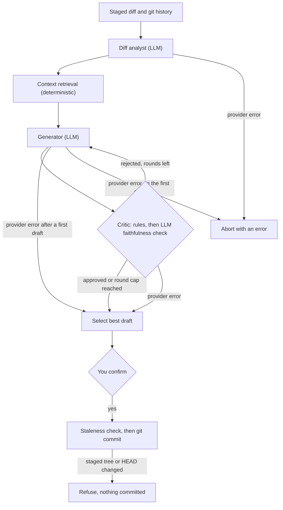
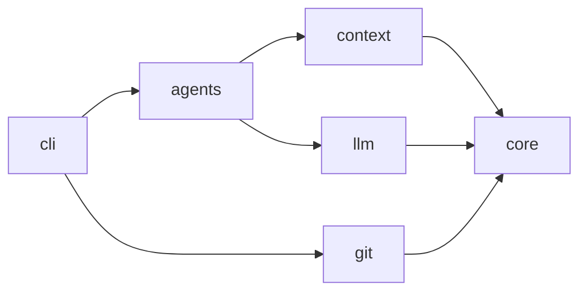

<div align="center">

<picture>
  <source media="(prefers-color-scheme: dark)" srcset="docs/assets/logo-dark.svg">
  
</picture>

**Commit messages in your repository's own voice, checked by rules before you see them.**

[](https://github.com/vaibhav-barman/gitcommit-ai/actions/workflows/ci.yml)
[](pyproject.toml)
[](LICENSE)
[](https://github.com/astral-sh/ruff)
[](https://mypy-lang.org/)

[Demo](#demo) · [Why it's different](#why-its-different) · [Quick start](#quick-start) · [How it works](#how-it-works) · [Reference](#reference) · [Evaluation](#evaluation) · [Roadmap](#roadmap)

</div>

---

GitCommit AI reads your staged diff and your commit history, works out how *your* repository writes commits, and drafts a message to match. A deterministic critic then checks the draft against the conventions it found, and sends it back for revision until it passes or the round budget runs out. It never stages anything, and it refuses to commit if the staging area changed while it was thinking.

## Demo

Record the real demo with `make demo`. It writes `docs/assets/demo.gif` and needs [VHS](https://github.com/charmbracelet/vhs), [uv](https://docs.astral.sh/uv/) and a provider key; the script is [`docs/demo.tape`](docs/demo.tape). Until that GIF exists, this is output captured from the real CLI with a deterministic stand-in for the model ([`scripts/eval/offline.py`](scripts/eval/offline.py)). The convention, the examples and the critic rounds come from the real pipeline. The message wording is mechanical, because no LLM wrote it.

```text
$ git ai-commit --verbose --dry-run          # sample output, offline stand-in model
Generating a commit message with fake/offline-heuristic...
Convention: scoped_conventional (confidence 100%, 8 commits analyzed)
Examples used (5):
  da03eed fix(api): return a copy of the orders list [score 4.3]
  e0feabc feat(api): add list_orders and get_order [score 3.5]
  d341f48 test(api): cover list_orders and get_order [score 2.4]
  679a850 fix(cli): print a message when there are no orders [score 2.0]
  63bdba6 feat(cli): add orders command [score 1.7]
Critic rounds (2):
  1. Updated api -> rejected
       [error] format: Use the form '<type>(<scope>): <description>'.
       [error] imperative-mood: 'Updated' is not imperative; start with the base verb (for example 'add').
       [error] capitalization: Start the description with a lowercase letter.
       [error] body-missing: Add a short body after a blank line explaining what changed and why; this repository's commits (or this large diff) call for one.
  2. fix(orders): fix api -> approved
       [warning] scope: Scope 'orders' has not been used in this repository. Known scopes: api, cli, models, readme.

fix(orders): fix api

Touches 2 file(s), mainly api.
```

Diagnostics go to stderr and the message goes to stdout, so `git ai-commit --dry-run` can be piped.

## Why it's different

| | A one-shot prompt (diff in, text out) | GitCommit AI |
|---|---|---|
| **Format** | Fixed in the prompt | Detects the repository's convention from recent history: Conventional (with or without scope), gitmoji, `[BRACKET]` prefix, or plain, with a confidence score |
| **Style** | Left to the model's defaults | Profiles subject length, capitalization, trailing period, scope usage, imperative mood and body habit, and states them as rules |
| **Examples** | None unless you paste them in | Past commits that touch similar paths, scopes, change types and keywords, weighted toward recent ones |
| **Checking** | None; you read the result | Deterministic rules judge the draft; the LLM is asked only whether the message is faithful to the diff. Rejected drafts are regenerated with the findings, up to `max_iterations` |
| **Failure** | Up to the client | Retries rate limits and transient errors with bounded backoff; a late provider error returns the best draft so far with a warning |
| **Committing** | Not addressed | Re-checks that the staged tree and `HEAD` are unchanged before committing; never runs `git add` |
| **Local-first** | Depends on the client | Ollama backend with no key; the context engine makes no LLM calls |
| **Measurable** | No built-in way to score the output | An [evaluation harness](#evaluation) replays your own history and scores the output with deterministic checks |

## Features

| Feature | What it does |
|---|---|
| **Convention detection** | Statistical, with sample-size-adjusted confidence and a plain-language evidence summary |
| **Style profiling** | Mean and median subject length, capitalization, punctuation, scope and body frequency, common scopes and types |
| **History-aware examples** | Scored on scope, path, change type and keyword overlap, with recency decay; every pick is explained |
| **Critic loop** | Format, scope, length, mood, capitalization, punctuation, breaking-change and body rules, then a faithfulness check |
| **Bodies** | A body wrapped at 72 columns when at least half of recent commits have one, or the diff is large |
| **`--hint`** | Tell it what the change is for; the message must still match the diff |
| **`--amend`, `--no-verify`** | Reword or extend the last commit; skip pre-commit and commit-msg hooks |
| **Commit hook** | `hook install` makes plain `git commit` open your editor with a proposal; existing hooks are backed up and chained |
| **Safe states** | Refuses mid-merge, cherry-pick or revert; notes a rebase; warns on a detached `HEAD` |
| **Providers** | Anthropic, Google Gemini, Hugging Face, OpenAI, OpenRouter and Ollama (local or remote) over plain HTTP, behind one small protocol |

## Quick start

**1. Install.** The package is not on PyPI yet, so install from a clone. Every provider works out of the box; there is nothing extra to install.

```bash
git clone https://github.com/vaibhav-barman/gitcommit-ai.git
cd gitcommit-ai
pipx install .
```

**2. Set a provider key.** Ollama needs none.

```bash
export OPENAI_API_KEY=sk-...
```

A `.env` file in the current directory or the repository root works too; see the configuration section of the [reference](#reference).

**3. First run.** Stage a change in any repository and preview the message without committing.

```bash
cd /path/to/your/repo
git add -p
git ai-commit --dry-run
```

**4. Optional: let plain `git commit` propose a message.**

```bash
git-ai-commit hook install
git commit
```

**5. Everyday use.**

```bash
git ai-commit                                   # print, confirm, commit
git ai-commit --hint "fixes the flaky retry test"
git ai-commit --amend                           # reword the last commit
```

### Providers

| Provider | Name | Key variable | Default model (environment-only setups) | Get a key |
|---|---|---|---|---|
| Anthropic | `anthropic` | `ANTHROPIC_API_KEY` | `claude-sonnet-5-5` | [console.anthropic.com](https://console.anthropic.com/settings/keys) |
| Google Gemini | `gemini` | `GOOGLE_API_KEY` or `GEMINI_API_KEY` | `gemini-2.5-flash` | [aistudio.google.com](https://aistudio.google.com/apikey) |
| Hugging Face | `huggingface` | `HF_TOKEN` | `deepseek-ai/DeepSeek-V4.1-Flash` | [a fine-grained token](https://huggingface.co/settings/tokens/new?ownUserPermissions=inference.serverless.write&tokenType=fineGrained) with "Make calls to Inference Providers" |
| OpenAI | `openai` | `OPENAI_API_KEY` | `gpt-4o-mini` | [platform.openai.com](https://platform.openai.com/api-keys) |
| OpenRouter | `openrouter` | `OPENROUTER_API_KEY` | `anthropic/claude-sonnet-5.5` | [openrouter.ai](https://openrouter.ai/settings/keys) |
| Ollama | `ollama` | none for a local server; `OLLAMA_API_KEY` for Ollama Cloud or a protected server | `llama3.1` | [ollama.com](https://ollama.com/settings/keys) (cloud only) |

Choose one with `--provider` and `--model`, or with `GITCOMMIT_AI_PROVIDER` and `GITCOMMIT_AI_MODEL`.

## How it works



The graph runs on [LangGraph](https://github.com/langchain-ai/langgraph). Everything the agents consume comes from deterministic code, and LLM calls happen only inside `git_commit_ai.agents`. Dependencies point one way:



[`docs/architecture.md`](docs/architecture.md) has the state schema, node contracts, critic rules and design decisions.

## Reference

<details>
<summary><b>Commands and flags</b></summary>

<br>

`git ai-commit` runs `generate` directly; `gitcommit-ai generate` is the same command. Git intercepts `--help` for external commands, so use `git ai-commit -h`, or `git-ai-commit --help`.

| Flag | Meaning |
|---|---|
| `--provider` | `openai`, `anthropic`, `gemini`, `openrouter`, `huggingface`, or `ollama` |
| `--model`, `-m` | Model name (default: the provider's default) |
| `--dry-run` | Print the message and exit without committing |
| `--yes`, `-y` | Commit without the confirmation prompt; refused if a provider error cut the run short |
| `--accept-partial` | Let `--yes` commit a draft left unfinished by a provider error |
| `--max-iterations` | Cap on generate/critique rounds (1–10) |
| `--hint "text"` | What the change is for, in your own words (up to 1000 characters) |
| `--amend` | Replace the last commit; the message covers it plus any staged changes |
| `--no-verify` | Skip the pre-commit and commit-msg hooks when committing |
| `--verbose`, `-v` | Show the detected convention, examples used, and critic rounds |
| `--path`, `-p` | Repository path (default: current directory) |

| Command | What it does |
|---|---|
| `git-ai-commit config` | Show every setting, where it came from, and API keys masked to their last four characters |
| `git-ai-commit hook install` / `hook uninstall` | Manage the `prepare-commit-msg` hook (both accept `--path`) |
| `gitcommit-ai inspect` | Repository root, branch, detached `HEAD`, staged, unstaged and untracked files (`--path`) |
| `gitcommit-ai diff` | Diff statistics for staged changes (`--unstaged`, `--path`) |
| `gitcommit-ai history` | Recent non-merge commit subjects (`--count`, `--path`) |
| `gitcommit-ai context` | Detected convention, style profile and evidence (`--count`, `--path`) |
| `gitcommit-ai examples` | Historical commits relevant to your change, with reasons (`--max-examples`, `--unstaged`, `--path`) |

`gitcommit-ai` offers every command above, including `generate`, `config` and `hook`. `git-ai-commit` takes the flags of `generate` directly (for example `git ai-commit --verbose`) and also offers `config` and `hook`.

</details>

<details>
<summary><b>Configuration and precedence</b></summary>

<br>

Settings are resolved in this order, highest priority first:

1. **Command-line flags** (`--provider`, `--model`, `--max-iterations`)
2. **Environment variables**
3. **A `.env` file**, read from the current directory or, failing that, the root of the Git repository. Parent directories above the repository root and your home directory are never searched
4. **The saved config file**, `config.toml` in your per-user config directory (`GITCOMMIT_AI_CONFIG_DIR`). It never holds API keys; saved keys live next to it in `credentials.toml`, readable only by you
5. **Defaults**

API keys follow the same order: a key variable in the environment, then in `.env`, then the saved key.

The `.env` file is parsed into memory only and never exported into the process environment. Blank values count as unset. Set `GITCOMMIT_AI_ENV_FILE` to use a specific file, or to an empty string to skip `.env` loading. [`.env.example`](.env.example) is a template. `git-ai-commit config` shows what is in effect:

```text
$ git-ai-commit config
Effective settings
  Precedence: flags > environment > .env > config file > defaults
  .env file:  none found
  Config file: none

  GITCOMMIT_AI_PROVIDER          openai                           [default]
  GITCOMMIT_AI_MODEL             (provider default: gpt-4o-mini)  [default]
  GITCOMMIT_AI_TEMPERATURE       0.3                              [default]
  ...

API keys
  openai      OPENAI_API_KEY = not set
  anthropic   ANTHROPIC_API_KEY = not set
  gemini      GOOGLE_API_KEY = not set
  openrouter  OPENROUTER_API_KEY = not set
  huggingface HF_TOKEN = not set
  ollama      OLLAMA_API_KEY = not set (only for Ollama Cloud or a protected server)
```

| Variable | Default | Meaning |
|---|---|---|
| `GITCOMMIT_AI_PROVIDER` | `openai` | `openai`, `anthropic`, `gemini`, `openrouter`, `huggingface`, or `ollama` |
| `GITCOMMIT_AI_MODEL` | provider default | Model name |
| `GITCOMMIT_AI_TEMPERATURE` | `0.3` | Sampling temperature (0–2) |
| `GITCOMMIT_AI_TIMEOUT` | `60` | Seconds per LLM request |
| `GITCOMMIT_AI_OLLAMA_URL` | `http://localhost:11434` | Ollama server |
| `GITCOMMIT_AI_MAX_RETRIES` | `3` | Retries after a rate limit or transient error (0 disables) |
| `GITCOMMIT_AI_RETRY_BASE_DELAY` | `1` | Seconds before the first retry; doubles each time |
| `GITCOMMIT_AI_RETRY_MAX_DELAY` | `30` | Longest wait before a retry; a longer `retry-after` is not waited out |
| `GITCOMMIT_AI_MAX_ITERATIONS` | `3` | Generate/critique rounds (1–10) |
| `GITCOMMIT_AI_MAX_DIFF_CHARS` | `24000` | Diff characters sent to the model (min 1000) |
| `GITCOMMIT_AI_ENV_FILE` | none | A specific env file, or empty to skip `.env` loading |
| `GITCOMMIT_AI_CONFIG_DIR` | per OS | Directory for the saved settings and keys (`config.toml`, `credentials.toml`); by default `~/.config/gitcommit-ai`, or `%APPDATA%\gitcommit-ai` on Windows |
| `GITCOMMIT_AI_HOOK` | unset | Set to `0` to skip the commit hook for one commit |

</details>

<details>
<summary><b>Behavior and edge cases</b></summary>

<br>

- **Nothing staged**: exits with code 1 and a hint if you have unstaged changes. Nothing is ever staged for you.
- **Empty repository**: works. With no history there is no convention to match, so Conventional Commits is used.
- **Binary-only diffs**: the message is based on file names and stats, and you are told so.
- **Large diffs**: each file's patch gets a share of a character budget. Small patches stay whole, large ones are truncated at a line boundary, and files that do not fit are listed by name only. A notice tells you when this happened.
- **No approved draft**: after `max_iterations` rounds the best draft is shown with the issues the critic still has.
- **Retries and provider errors**: rate limits and transient errors are retried with backoff and announced on stderr. If a provider still fails after the first draft exists (during the critic or a later round), the best draft so far is shown with a yellow "Stopped early" warning. A failure before any draft exists is an error.
- **`--yes` and interrupted runs**: if a provider error stopped the run early, `--yes` prints the draft, then exits with code 1 and commits nothing. Pass `--accept-partial` to allow it. A draft the critic merely did not approve after `max_iterations` rounds is still committed by `--yes`; the warning is on stderr.
- **Bodies**: a short body, wrapped at 72 columns, is generated when at least half of the recent commits have one or the diff is large (6+ files or 200+ changed lines). Otherwise the message is a subject line only.
- **`--hint`** steers the type and wording, but the message must still match the diff.
- **`--amend`**: the message describes `HEAD` together with staged changes, and `HEAD` itself is not used as an example. If `HEAD` moved while generating, nothing is amended.
- **Staleness guard**: if the staged changes (or `HEAD`) differ from what the message was written for, nothing is committed (exit code 1).
- **Merge, cherry-pick, revert in progress**: refused, because Git already prepared the message; finish with `git commit`. A **rebase** in progress proceeds with a note. On a **detached `HEAD`** you are warned before committing.
- **Hooks** run as usual when committing; `--no-verify` skips pre-commit and commit-msg, but not `prepare-commit-msg`.

**The commit hook.** `git-ai-commit hook install` writes a `prepare-commit-msg` hook:

- An existing hook is **never overwritten**. It is moved to `prepare-commit-msg.pre-ai-commit`, still runs first, and `hook uninstall` puts it back. Installing twice just refreshes the script.
- It does nothing for commits that already have a message (`-m`, `-F`, `--amend`, merges, squashes), when `GITCOMMIT_AI_HOOK=0` is set, or when `git-ai-commit` is not on your `PATH`.
- It **never blocks a commit**: with no staged changes, a missing API key, or a provider failure it prints a note and your commit continues.
- It respects `core.hooksPath` and linked worktrees.

</details>

<details>
<summary><b>Troubleshooting</b></summary>

<br>

| You see | Cause and fix |
|---|---|
| `Nothing is staged. Stage your changes first` | Run `git add` first; GitCommit AI never stages for you |
| `No API key for provider 'openai'. Set the OPENAI_API_KEY environment variable.` | Export the key, or put it in a `.env` in the current directory or repository root. `git-ai-commit config` shows what was found and where |
| `openai rejected the API key (HTTP 401).` | The key is wrong, revoked, or lacks permission. Replace it; `git-ai-commit config` shows which key was used and where it came from |
| `Could not reach Ollama at http://localhost:11434.` | Start it with `ollama serve`, or set `GITCOMMIT_AI_OLLAMA_URL` |
| Yellow `Stopped early: ...` | A provider error cut the run short. The best draft is shown. Rerun, or commit it yourself; `--yes` needs `--accept-partial` |
| `The staged changes changed while the message was being generated` | You staged or committed during generation. Nothing was committed; run it again |
| `A merge is in progress.` (or cherry-pick, revert) | Git prepared the message already; finish with `git commit` |
| `git ai-commit --help` opens a man page error | Git intercepts `--help` for external commands. Use `git ai-commit -h` |
| `.env` values are ignored | Only the current directory and the repository root are searched. Run `git-ai-commit config` and read the `.env file:` line |
| The hook never proposes anything | It skips commits with a message, `GITCOMMIT_AI_HOOK=0`, and a missing `git-ai-commit` on `PATH`. A problem prints a note and never blocks the commit |

</details>

<details>
<summary><b>Project layout</b></summary>

<br>

```text
gitcommit-ai/
├── src/git_commit_ai/
│   ├── core/       config, settings (flags > env > .env > config file), saved config and keys, schemas, exceptions
│   ├── git/        repository, diff, history, snapshots, committer, hook installer
│   ├── context/    normalizer, convention detector, style analyzer, example selector, engine
│   ├── llm/        provider protocol, HTTP layer, factory, retry, FakeLLM, backends
│   ├── agents/     state, analyst, retrieval, generator, critic rules and node, graph
│   └── cli/        main app, generate, config, hook, git subcommand entry point
├── scripts/
│   ├── eval/       evaluation harness (not installed)
│   └── demo/       builds the repository that docs/demo.tape records
├── tests/          unit, integration and eval tests; no network
├── docs/           architecture.md, demo.tape, assets/ (logos)
├── .github/workflows/ci.yml
├── Makefile        `make demo`
├── CHANGELOG.md, CONTRIBUTING.md, LICENSE, .env.example, pyproject.toml
└── README.md
```

</details>

## Evaluation

[`scripts/eval`](scripts/eval/README.md) replays a repository's last N non-merge commits through the full agent graph. For each commit it uses the diff against the parent and only the commits older than it as history, then scores the message against the real one with deterministic checks: convention, subject length against the style profile, imperative mood, capitalization, punctuation, scope and body agreement, critic findings before and after reflection, and rounds used.

```bash
uv run python -m scripts.eval /path/to/repo --offline                       # no network, no key
uv run python -m scripts.eval /path/to/repo --provider anthropic -n 30      # a live run
```

`--offline` swaps the model for a deterministic stand-in, so it tests the harness and says nothing about any model. Results from live runs have not been collected yet:

| Repository | Model | Commits | Convention match | Imperative mood | Critic-clean first draft | Critic-clean final draft |
|---|---|---:|---:|---:|---:|---:|
| TBD | TBD | TBD | TBD | TBD | TBD | TBD |

## Development

```bash
uv sync                       # no provider SDKs: every provider is plain HTTP
uv run pytest                 # no network, no API keys
uv run ruff check . && uv run ruff format --check .
uv run mypy src tests scripts # strict
uv run python -m scripts.check_docs   # every flag, variable, path and link in the docs vs the code
```

Tests run in temporary Git repositories and drive the agents with `FakeLLM`; provider backends run against a fake HTTP transport, and any real network request fails the test. CI runs Ruff, mypy and the tests on Python 3.11, 3.12 and 3.13, plus a packaging smoke test. See [CONTRIBUTING.md](CONTRIBUTING.md) and the [CHANGELOG](CHANGELOG.md).

## Roadmap

- [x] Git intelligence layer: inspection, diffs, history, staleness-guarded snapshots
- [x] Context engine: convention detection, style profiling, example retrieval
- [x] LangGraph agents with a critic-driven reflection loop; OpenAI, Anthropic, Gemini and Ollama
- [x] Hardening: retries, graceful degradation, `.env` and `config`, `--hint`, bodies, `--amend`, commit hook
- [x] CI on Python 3.11–3.13, typed package, license, contributing guide, changelog
- [x] Evaluation harness with an offline mode
- [ ] Record the demo GIF (`make demo`)
- [ ] Publish live evaluation results
- [ ] Publish to PyPI
- [ ] Interactive terminal UI for reviewing and editing the proposed message

## Contributing and license

Contributions are welcome: start with [CONTRIBUTING.md](CONTRIBUTING.md). Released under the [MIT License](LICENSE).
