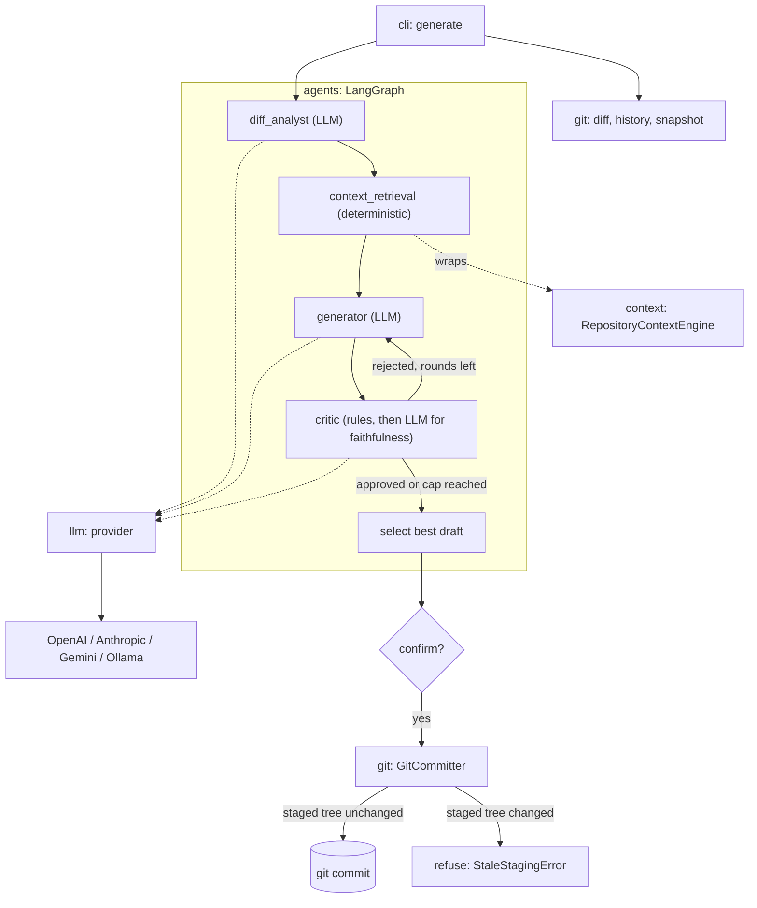

# GitCommit AI

[](https://www.python.org/downloads/)
[](https://github.com/astral-sh/uv)
[](https://github.com/astral-sh/ruff)
[](http://mypy-lang.org/)

**GitCommit AI** is a production-oriented developer tool designed to generate clean, semantic, and deeply contextual Git commit messages. It combines deterministic Git repository intelligence and historical style analysis with future agentic AI workflows.

---

## 🌟 Long-Term Architectural Vision

Modern software changes are complex, cross-cutting, and full of context that simple one-shot LLM prompts fail to capture. GitCommit AI is built to overcome these limitations through an agentic pipeline:

- **Deterministic Context Engineering**: Statistical convention detection, repository style profiling, and recency-decayed historical example retrieval before any AI model is invoked.
- **LangGraph Multi-Agent Orchestration**: A structured state graph coordinating specialized AI agents.
- **Specialized Agents**:
  - *Diff Analyst Agent*: Deconstructs unified diffs, identifies architectural changes, and filters noise.
  - *Context Retrieval Agent*: Synthesizes repository history, commit conventions, and branch semantics.
  - *Commit Generator Agent*: Crafts high-quality Conventional Commit messages (type, scope, subject, body, breaking changes).
  - *Reflection & Critique Agent*: Evaluates proposed commits against team standards, repository history, and diff reality.
- **Staleness Guarding**: Tree-hash snapshotting ensures that any changes staged while generation is underway abort or trigger re-analysis before any commit can occur.
- **Hybrid Cloud / Local LLM Inference**: Pluggable backend support for OpenAI, Anthropic, Google Gemini, Ollama, and local llama.cpp servers.

> **Current Milestone**: Phases 1–3 are complete. Repository inspection, diff extraction, commit normalization, statistical convention detection, style profiling, and example retrieval (Phases 1 and 2) run 100% deterministically with zero LLM dependencies. Phase 3 adds the LangGraph agent graph, four pluggable LLM backends, and the `generate` command; LLM calls happen only inside `git_commit_ai.agents`.

---

## 🚀 Implemented Capabilities

### 1. Git Intelligence Layer (Phase 1)
- **Repository Inspection (`RepositoryInspector`)**:
  - Detects Git repository boundaries and resolves absolute root paths.
  - Tracks branch names and detects detached HEAD states.
  - Identifies staged files, unstaged modified files, and untracked files.
  - Safely handles newly initialized repositories with zero commits (empty repos).
- **Diff Extraction (`DiffExtractor`)**:
  - Focuses by default strictly on **staged** changes (`DiffMode.STAGED`).
  - Generates unified diff output, numstat counts (additions and deletions), and name-status change codes.
  - Detects file renames (`old_path -> path`) and flags binary files (`is_binary`).
  - Never automatically stages, unstages, modifies, or discards repository content.
- **Historical Commit Extraction (`CommitHistoryExtractor`)**:
  - Retrieves recent non-merge commits (configurable count, default 10).
  - Uses explicit field and commit delimiters in `git log` formatting to robustly parse multiline bodies and special characters.
- **Snapshot Management (`SnapshotManager`)**:
  - Captures deterministic staged tree hashes (`git write-tree`) for race-condition and staleness detection.

### 2. Repository Context Engine (Phase 2)
- **Commit Normalization (`CommitNormalizer`)**:
  - Parses and decomposes raw commit messages into semantic components (type, scope, breaking flag, subject, body, footers).
  - Normalizes Conventional Commits, bracket-prefixed commits (`[AUTH]`), Gitmoji (both shortcodes and unicode), and unstructured plain messages.
  - Extracts breaking change footers (`BREAKING CHANGE:` / `BREAKING-CHANGE:`) and subject exclamation marks (`feat!: ...`).
- **Commit Convention Detection (`CommitConventionDetector`)**:
  - Statistically identifies repository convention (`conventional`, `scoped_conventional`, `gitmoji`, `bracket_prefix`, `plain`).
  - Calculates confidence scores adjusted for sample size penalties when evaluating small histories.
  - Generates human-readable evidence summaries explaining why a convention was detected.
- **Repository Style Profiling (`RepositoryStyleAnalyzer`)**:
  - Analyzes subject length metrics (average and median character counts).
  - Evaluates capitalization patterns (`lowercase`, `uppercase`, `mixed`).
  - Detects trailing punctuation standards (e.g. trailing periods vs. no periods).
  - Quantifies body usage frequency and scope usage frequency.
  - Identifies common repository scopes and frequency distributions across commit types.
  - Measures imperative mood adherence using heuristic verb analysis.
  - Detects temporal convention shifts between historical baselines and recent commits.
- **Recency-Aware Example Retrieval (`HistoricalExampleSelector`)**:
  - Employs a multi-factor heuristic scoring function matching staged changes against commit history:
    - Scope matching (+3.0)
    - Path and filename matching (+2.0)
    - Inferred change type matching (+1.5)
    - Keyword overlap (+0.5 to +1.5)
    - Recency decay weighting ($1 / (1 + \lambda \cdot \text{rank})$)
  - Provides explainable selection reasons for every retrieved example.
- **Unified Context Engine (`RepositoryContextEngine`)**:
  - Coordinates normalizer, convention detector, style analyzer, and example selector into a cohesive `RepositoryContext` payload ready for future LLM prompt injection.

### 3. Agentic Generation (Phase 3)
- **LLM Providers (`git_commit_ai.llm`)**:
  - A small `LLMProvider` protocol (`name`, `model`, `complete`) with OpenAI, Anthropic, Gemini, and Ollama backends. SDKs are optional extras, so the base install stays light.
  - `create_provider()` selects the backend from configuration and reads API keys from the environment.
  - Typed errors: `MissingAPIKeyError`, `ProviderNotInstalledError`, `OllamaUnreachableError`, `RateLimitError` (with the server's retry hint), `LLMResponseError`.
  - A deterministic `FakeLLM` for tests; no test touches the network.
- **LangGraph Orchestration (`git_commit_ai.agents`)**:
  - *Diff analyst*: reads a budgeted rendering of the staged diff and returns the change type, summary, intent, breaking flag, and scope hint.
  - *Context retrieval*: wraps `RepositoryContextEngine`; no LLM and no reimplementation.
  - *Generator*: builds its prompt from the detected convention, the style profile, and retrieved examples, and revises using the critic's feedback.
  - *Critic*: deterministic rules first (format, scope, subject length, imperative mood, capitalization, punctuation, breaking-change marking, body habit); the LLM is asked only whether the message is faithful to the diff.
  - *Reflection loop*: generate → critique → regenerate, capped by `max_iterations`, falling back to the best draft.
- **Safe committing (`GitCommitter`)**: re-checks the staged tree against a snapshot taken before generation and refuses to commit if it changed.

---

## 🛠️ Installation & Setup

GitCommit AI uses [uv](https://github.com/astral-sh/uv) for fast, deterministic Python environment and dependency management.

### Prerequisites

- Python 3.12 or newer
- [uv](https://github.com/astral-sh/uv) installed (`curl -LsSf https://astral.sh/uv/install.sh | sh` or `brew install uv`)
- Git installed and accessible on your `PATH`

### Setup

Clone the repository and install dependencies:

```bash
git clone https://github.com/vaibhav-barman/gitcommit-ai.git
cd gitcommit-ai

# Sync dependencies and create virtual environment
uv sync
```

### Choosing an LLM provider

Provider SDKs are optional extras. Install the one you need, or all of them:

```bash
uv sync --extra openai      # or: anthropic, gemini, ollama
uv sync --all-extras        # every provider
```

| Provider | Extra | API key variable | Default model |
|---|---|---|---|
| OpenAI | `openai` | `OPENAI_API_KEY` | `gpt-4o-mini` |
| Anthropic | `anthropic` | `ANTHROPIC_API_KEY` | `claude-sonnet-5-5` |
| Gemini | `gemini` | `GOOGLE_API_KEY` | `gemini-2.5-flash` |
| Ollama | `ollama` | none (local server) | `llama3.1` |

Using a provider whose extra is not installed fails with the exact `pip install 'gitcommit-ai[...]'` command to run.

### Configuration

Settings come from environment variables; command-line flags override them. See [`.env.example`](.env.example) for the full list. The CLI does **not** load `.env` files, so export the variables yourself (`set -a; source .env; set +a`).

| Variable | Default | Meaning |
|---|---|---|
| `GITCOMMIT_AI_PROVIDER` | `openai` | `openai`, `anthropic`, `gemini`, or `ollama` |
| `GITCOMMIT_AI_MODEL` | provider default | Model name |
| `GITCOMMIT_AI_TEMPERATURE` | `0.3` | Sampling temperature (0–2) |
| `GITCOMMIT_AI_TIMEOUT` | `60` | Seconds per LLM request |
| `GITCOMMIT_AI_OLLAMA_URL` | `http://localhost:11434` | Ollama server |
| `GITCOMMIT_AI_MAX_ITERATIONS` | `3` | Generate/critique rounds (1–10) |
| `GITCOMMIT_AI_MAX_DIFF_CHARS` | `24000` | Diff characters sent to the model (min 1000) |

### Using it as `git ai-commit`

Git runs any executable named `git-<name>` on your `PATH` as `git <name>`. Installing the package puts `git-ai-commit` next to `gitcommit-ai`:

```bash
uv tool install ".[openai]"     # or: pipx install ".[openai]"
git ai-commit --dry-run
```

`git ai-commit` runs `generate` directly. Git intercepts `--help` for external commands and looks for a man page, so use `git ai-commit -h` (or `git-ai-commit --help`) for help.

---

## 💻 CLI Usage

Invoke commands using `uv run gitcommit-ai` or directly within an activated environment:

### 1. Inspect Repository State
Inspect the current repository root, branch, detached HEAD status, and categorized files:

```bash
uv run gitcommit-ai inspect
# Or inspect a specific target path
uv run gitcommit-ai inspect --path /path/to/repo
```

### 2. View Diff Statistics
View aggregate statistics and changed file breakdowns for staged changes:

```bash
uv run gitcommit-ai diff
# Inspect unstaged changes instead
uv run gitcommit-ai diff --unstaged
```

### 3. View Recent Commit History
Display recent non-merge commits:

```bash
uv run gitcommit-ai history
# Customize commit count
uv run gitcommit-ai history --count 5
```

### 4. Analyze Commit Conventions & Writing Style
Analyze repository commit patterns, subject length, capitalization, and scope usage:

```bash
uv run gitcommit-ai context
# Analyze with custom commit sample size
uv run gitcommit-ai context --count 50
```

*Example Output:*
```text
Repository Commit Context
  Convention:     SCOPED_CONVENTIONAL (confidence: 100.0%)
  Analyzed:       10 commits

Style Characteristics
  Subject length: 45.2 chars avg / 44.5 chars median
  Capitalization: lowercase
  Punctuation:    no_trailing_period
  Body frequency: 100.0%
  Scope usage:    80.0%
  Imperative:     70.0%

Common Types:
  feat: 8
  docs: 1
  test: 1

Common Scopes:
  context, cli, git

Evidence:
  - 10 of 10 commits (100.0%) follow Conventional Commits format.
  - 8 of 10 conventional commits (80.0%) specify a scope.
```

### 5. Retrieve Relevant Historical Examples
Retrieve historical commits matching your current staged or unstaged changes:

```bash
# Match against staged changes (default)
uv run gitcommit-ai examples

# Match against unstaged changes
uv run gitcommit-ai examples --unstaged

# Limit maximum number of examples
uv run gitcommit-ai examples --max-examples 3
```

*Example Output:*
```text
Relevant Historical Examples for Unstaged Changes (5)

  1. [8e33257] feat(cli): add Typer CLI with inspect, diff, and history commands (Score: 3.57)
     - Implement gitcommit-ai inspect to view repo root, branch, detached HEAD, staged/unstaged/untracked files...
     ✓ Matches scope 'cli' found in changed files
     ✓ Matches inferred change type 'feat'
     ✓ Shares keywords with change: cli

  2. [16a04e2] feat(context): detect repository commit conventions (Score: 1.74)
     - Implement CommitConventionDetector using statistical distribution analysis...
     ✓ Matches inferred change type 'feat'
     ✓ Shares keywords with change: commit
```

### 6. Generate a Commit Message
Generate a message for the staged changes. The message goes to **stdout**; progress, the verbose report, and warnings go to **stderr**, so `--dry-run` output can be piped.

```bash
git add -p
uv run gitcommit-ai generate --dry-run     # print only
uv run gitcommit-ai generate               # print, confirm, then commit
uv run gitcommit-ai generate --yes         # commit without asking
uv run gitcommit-ai generate --provider anthropic --model claude-sonnet-5-5 --verbose
```

| Flag | Meaning |
|---|---|
| `--provider` | `openai`, `anthropic`, `gemini`, or `ollama` |
| `--model`, `-m` | Model name (default: the provider's default) |
| `--dry-run` | Print the message and exit without committing |
| `--yes`, `-y` | Commit without the confirmation prompt |
| `--max-iterations` | Cap on generate/critique rounds (1–10) |
| `--verbose`, `-v` | Show the detected convention, examples used, and critic rounds |
| `--path`, `-p` | Repository path (default: current directory) |

*Example `--verbose` output (stderr, then stdout):*
```text
Generating a commit message with openai/gpt-4o-mini...
Convention: scoped_conventional (confidence 100%, 5 commits analyzed)
Examples used (4):
  c74428e feat(api): add teams endpoint [score 3.9]
  9a8412c feat(api): add users endpoint [score 3.8]
  9ed3c79 fix(api): handle empty list [score 3.0]
  3799839 feat(cli): add entry point [score 1.4]
Critic rounds (2):
  1. Added orders endpoint -> rejected
       [error] format: Use the form '<type>(<scope>): <description>'.
       [error] imperative-mood: 'Added' is not imperative; start with the base verb (for example 'add').
       [error] capitalization: Start the description with a lowercase letter.
  2. feat(api): add orders endpoint -> approved

feat(api): add orders endpoint
```

**Behavior to know about**
- **Nothing staged**: exits with code 1 and a hint if you have unstaged changes. Nothing is ever staged for you.
- **Empty repository**: works; with no history there is no convention to match, so Conventional Commits is used.
- **Binary-only diffs**: the message is based on file names and stats, and you are told so.
- **Large diffs**: each file's patch gets a share of a character budget; small patches stay whole, large ones are truncated at a line boundary, and files that do not fit are listed by name only. A notice tells you when this happened.
- **No approved draft**: after `max_iterations` rounds the best draft is shown along with the issues the critic still has.
- **Staleness guard**: if the staged changes differ from what the message was written for, nothing is committed (exit code 1).
- **Hooks** run as usual when committing.

---

## 🏗️ Architecture

Dependencies point one way: `cli → agents → context → git/core`. The `llm` package is used only by `agents` (and by the CLI to build the provider).



See [docs/architecture.md](docs/architecture.md) for the state schema, node contracts, critic rules, and design decisions.

---

## 🧪 Testing & Quality Assurance

GitCommit AI maintains strict quality standards: 100% type-annotated (`mypy` strict mode), linted and formatted with `ruff`, and verified against temporary Git repositories using `pytest`.

```bash
# Run complete test suite (263 unit + integration tests, no network)
uv run pytest -v

# Run linter
uv run ruff check .

# Check formatting
uv run ruff format --check .

# Run static type checking
uv run mypy src/ tests/
```

Tests run in isolated temporary repositories generated by pytest fixtures and will never modify your working repository. LLM behavior is covered with `FakeLLM` and mocked SDK clients, so the suite needs no API keys or network access. Install every provider SDK (`uv sync --all-extras`) before running it, because the backend tests import them.

---

## 📂 Project Structure

```
gitcommit-ai/
├── src/
│   └── git_commit_ai/
│       ├── __init__.py
│       ├── core/
│       │   ├── __init__.py
│       │   ├── config.py             # Pydantic configuration model
│       │   ├── exceptions.py         # Application exception hierarchy
│       │   └── schemas.py            # Typed Pydantic models & StrEnums
│       ├── git/
│       │   ├── __init__.py
│       │   ├── diff.py               # Staged & unstaged diff extraction
│       │   ├── history.py            # Delimited historical commit parsing
│       │   ├── repository.py         # Subprocess-safe repository inspector
│       │   ├── snapshots.py          # Staged tree identity & staleness guard
│       │   └── committer.py          # Staleness-guarded `git commit`
│       ├── context/
│       │   ├── __init__.py
│       │   ├── normalizer.py         # Semantic commit normalization & parsing
│       │   ├── convention_detector.py# Statistical convention detection & confidence
│       │   ├── style_analyzer.py     # Repository style profiling & metrics
│       │   ├── example_selector.py   # Multi-factor heuristic example retrieval
│       │   └── engine.py             # Context engine orchestration pipeline
│       ├── llm/
│       │   ├── __init__.py
│       │   ├── base.py               # LLMProvider protocol & message types
│       │   ├── factory.py            # create_provider(): config -> backend
│       │   ├── fake.py               # Deterministic FakeLLM for tests
│       │   ├── openai_provider.py    # OpenAI backend
│       │   ├── anthropic_provider.py # Anthropic backend
│       │   ├── gemini_provider.py    # Gemini backend
│       │   └── ollama_provider.py    # Ollama backend
│       ├── agents/
│       │   ├── __init__.py
│       │   ├── state.py              # AgentState, drafts, critiques
│       │   ├── diff_budget.py        # Fit large diffs into a prompt budget
│       │   ├── llm_json.py           # Validated JSON replies with retry
│       │   ├── diff_analyst.py       # Node: what does the diff do and why
│       │   ├── context_retrieval.py  # Node: wraps the context engine
│       │   ├── conventions.py        # Convention rules shared by generator & critic
│       │   ├── generator.py          # Node: convention-aware drafting
│       │   ├── critic_rules.py       # Deterministic style/format rules
│       │   ├── critic.py             # Node: rules, then LLM faithfulness check
│       │   └── graph.py              # Reflection loop, routing, best-draft fallback
│       └── cli/
│           ├── __init__.py
│           ├── main.py               # Typer CLI application
│           └── generate.py           # `generate` command & `git ai-commit` entry
├── tests/
│   ├── conftest.py                   # Shared pytest fixtures
│   ├── fixtures/
│   │   ├── git_repo.py               # Isolated temp git repository factories
│   │   ├── diffs.py                  # Synthetic DiffResult builders
│   │   ├── agent_inputs.py           # Prepared AgentState builders
│   │   └── scripted_llm.py           # FakeLLM that answers per agent role
│   ├── unit/
│   │   ├── agents/                   # Nodes, critic rules, graph routing
│   │   ├── llm/                      # FakeLLM, backends (mocked SDKs), factory
│   │   ├── test_config.py            # Configuration tests
│   │   ├── test_schemas.py           # Schema & enum unit tests
│   │   ├── test_normalizer.py        # Commit normalizer tests
│   │   ├── test_convention_detector.py # Convention detector tests
│   │   ├── test_style_analyzer.py    # Style analyzer tests
│   │   ├── test_example_selector.py  # Example selector tests
│   │   └── test_context_engine.py    # Context engine tests
│   └── integration/
│       ├── test_cli.py               # CLI inspection & diff tests
│       ├── test_cli_context.py       # CLI context & examples tests
│       ├── test_cli_generate.py      # generate command, edge cases, git entry
│       ├── test_committer.py         # Staleness-guarded commit tests
│       ├── test_graph.py             # Whole graph against temp repos
│       ├── test_diff.py              # Diff extraction & rename tests
│       ├── test_history.py           # Commit history extraction tests
│       ├── test_repository.py        # Repository inspection tests
│       └── test_snapshots.py         # Snapshot comparison tests
├── docs/
│   └── architecture.md               # Detailed architectural documentation
├── .env.example
├── .gitignore
├── pyproject.toml
└── README.md
```

---

## 🗺️ Roadmap

- **Phase 1 (Completed)**: Project Foundation & Git Intelligence Layer.
- **Phase 2 (Completed)**: Repository Context Engine & Historical Commit Intelligence.
- **Phase 3 (Completed)**: LLM provider abstraction (OpenAI, Anthropic, Gemini, Ollama), LangGraph agent graph with a critic-driven reflection loop, the `generate` command, and the `git ai-commit` subcommand.
- **Phase 4**: Interactive terminal UI for reviewing and editing the proposed message.
