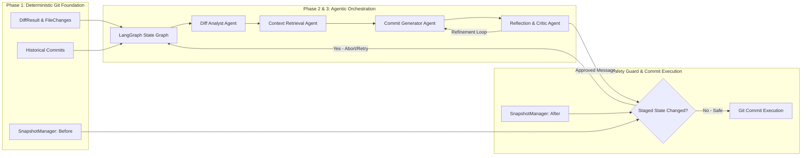

# GitCommit AI — Architecture Documentation

This document describes the design, system architecture, data flow, safety guarantees, and future AI integration points of **GitCommit AI**.

---

## 1. Architectural Philosophy

> **Core Principle**: *GitCommit AI must be deterministic and reliable at the repository-inspection layer. AI orchestration will be built on top of this foundation, never mixed into it.*

Git operations (diff extraction, commit history analysis, working-tree inspection) are deterministic system interactions with strict correctness and security requirements. By decoupling the deterministic Git layer from the non-deterministic AI generation layer, GitCommit AI guarantees:
1. **Zero Unexpected Modifications**: The Git intelligence layer never modifies, stages, unstages, or discards repository content.
2. **Subprocess Safety**: Command injection vulnerabilities are structurally eliminated.
3. **Structured Contracts**: All communication between system layers happens through typed Pydantic models rather than raw strings or unstructured dictionaries.
4. **Resilience to Race Conditions**: Working-tree snapshotting guarantees that if files change during AI generation, stale commit messages cannot be committed blindly.

---

## 2. Module Responsibilities

The codebase follows a `src`-based package layout (`src/git_commit_ai/`) divided into cohesive packages:

```
src/git_commit_ai/
├── core/       # Foundational domain contracts, configuration, and errors
├── git/        # Deterministic Git intelligence & subprocess orchestration
└── cli/        # User-facing terminal interface
```

### A. Core Module (`git_commit_ai.core`)

Contains data structures and runtime configuration shared across all layers:

- **`schemas.py`**:
  - `RepositoryInfo`: Metadata describing repo root, active branch, detached HEAD state, empty status, and categorized file lists (staged, unstaged, untracked).
  - `FileChange`: Granular change data for individual files (status, addition count, deletion count, binary flag, old path for renames/copies).
  - `DiffStatistics`: Aggregate change metrics (`files_changed`, `total_additions`, `total_deletions`).
  - `DiffResult`: Complete diff payload holding `raw_diff`, `file_changes`, `statistics`, and `mode`.
  - `HistoricalCommit`: Clean historical commit record containing `hash`, `subject`, and multiline `body`.
  - `RepositorySnapshot`: Immutable fingerprint containing `tree_hash`, `staged_files`, and timestamp for staleness checks.
  - `FileStatus` & `DiffMode`: `StrEnum` definitions enforcing domain type safety.
- **`config.py`**:
  - `GitCommitAIConfig`: Pydantic settings model validating command timeouts, default history counts, diff limits, and diff modes.
- **`exceptions.py`**:
  - Hierarchical domain exceptions rooted at `GitCommitAIError`:
    - `GitNotFoundError`: Git executable is not on `PATH`.
    - `NotAGitRepositoryError`: Provided directory is not inside a Git worktree.
    - `GitCommandError`: Subprocess exited with a non-zero exit code (captures `command`, `returncode`, `stderr`).
    - `GitTimeoutError`: Subprocess exceeded timeout threshold.
    - `EmptyRepositoryError`: Attempted an operation requiring commits on a fresh repository.

### B. Git Intelligence Module (`git_commit_ai.git`)

Implements all Git interactions using Python's `subprocess` standard library:

- **`repository.py` (`RepositoryInspector`)**:
  - Resolves absolute top-level directory (`git rev-parse --show-toplevel`).
  - Identifies active branch (`git symbolic-ref --short HEAD`) and detects detached HEAD.
  - Tracks staged files (`git diff --cached --name-only --diff-filter=ACDMRT`).
  - Tracks unstaged modifications (`git diff --name-only`).
  - Tracks untracked files (`git ls-files --others --exclude-standard`).
  - Handles repositories with zero commits.
- **`diff.py` (`DiffExtractor`)**:
  - Focuses by default strictly on **staged** changes (`DiffMode.STAGED`).
  - Captures raw unified diff with rename detection enabled (`-M`, `--no-color`).
  - Correlates addition/deletion counts from `git diff --numstat` with file statuses from `git diff --name-status`.
  - Resolves Git rename syntax (`old => new` and `{old => new}`) to identify original and destination paths.
  - Flags binary files without attempting lossy UTF-8 decoding.
- **`history.py` (`CommitHistoryExtractor`)**:
  - Extracts recent non-merge commits (`git log -n <count> --no-merges`).
  - Employs unique delimiters (`---GCAI_COMMIT_DELIM---` and `---GCAI_FIELD_DELIM---`) inside `--format` to parse multiline commit bodies and special characters reliably.
- **`snapshots.py` (`SnapshotManager`)**:
  - Computes the staged tree hash via `git write-tree` without creating a commit object.
  - Compares snapshots (`compare()`, `has_changed_since()`) to detect staged modifications occurring during execution.

### C. CLI Module (`git_commit_ai.cli`)

Builds the user-facing command-line tool using [Typer](https://typer.tiangolo.com/):

- `inspect`: Displays repository root, branch, detached HEAD status, and categorized file counts.
- `diff`: Displays staged (or unstaged via `--unstaged`) diff statistics and file change tables with status badges.
- `history`: Displays recent commit hashes and subjects with configurable `--count`.
- Error handling maps all `GitCommitAIError` exceptions to clean terminal stderr messages and exit code 1.

---

## 3. Git Command Execution & Safety Strategy

To guarantee absolute safety, all Git interactions adhere to the following rules:

1. **No Shell Invocations**: `shell=True` is strictly forbidden. Commands are passed exclusively as lists of arguments (`["git", "-C", repo_path, "diff", ...]`).
2. **Deterministic Timeouts**: Every subprocess execution enforces a timeout (default 30 seconds via `GitCommitAIConfig.git_timeout_seconds`), preventing hung processes from indefinitely blocking execution.
3. **Stream Capture**: `stdout` and `stderr` are captured and decoupled. On failure, `stderr` is wrapped inside `GitCommandError` for debugging.
4. **No Destructive Operations**: The application never invokes `git add`, `git reset`, `git checkout`, `git rm`, or `git clean`. It is read-only with respect to repository files and the Git index.
5. **Safe Diff Fallbacks**: In newly initialized repositories (no commits yet), diffing the index compares cleanly against the unborn state without crashing.

---

## 4. Data Flow

```mermaid
graph TD
    User([User / Terminal]) -->|CLI command| CLI[git_commit_ai.cli]
    CLI --> Inspector[RepositoryInspector]
    CLI --> DiffExt[DiffExtractor]
    CLI --> HistoryExt[CommitHistoryExtractor]
    CLI --> SnapMgr[SnapshotManager]

    Inspector -->|subprocess.run| GitCLI[(Git CLI Engine)]
    DiffExt -->|subprocess.run| GitCLI
    HistoryExt -->|subprocess.run| GitCLI
    SnapMgr -->|subprocess.run| GitCLI

    GitCLI -->|Stdout/Stderr| Inspector
    GitCLI -->|Stdout/Stderr| DiffExt
    GitCLI -->|Stdout/Stderr| HistoryExt
    GitCLI -->|Stdout/Stderr| SnapMgr

    Inspector -->|Validated Schema| RepoInfo[RepositoryInfo]
    DiffExt -->|Validated Schema| DiffRes[DiffResult]
    HistoryExt -->|Validated Schema| Commits[list[HistoricalCommit]]
    SnapMgr -->|Validated Schema| Snapshot[RepositorySnapshot]

    RepoInfo --> Formatter[Terminal Formatter / Future Agent State]
    DiffRes --> Formatter
    Commits --> Formatter
    Snapshot --> StalenessGuard[Staleness Guard]
```

---

## 5. Future AI Integration Points (Planned for Phase 2 & 3)

The clean abstraction boundary established in Phase 1 provides direct hook points for agentic workflows using **LangGraph** and **LangChain**:



### Planned AI Orchestration Components:

1. **State Graph (`git_commit_ai.orchestration.graph`)**:
   - Manages the agent state schema containing `diff_result`, `commit_history`, `proposed_messages`, `critique_feedback`, and `iteration_count`.
2. **Diff Analyst Agent**:
   - Decomposes file changes into logical units, distinguishes core logic from trivial edits/formatting, and detects breaking changes.
3. **Context Retrieval Agent**:
   - Analyzes recent commits to infer team conventions (e.g. Conventional Commits prefix styles, JIRA ticket patterns).
4. **Commit Generator Agent**:
   - Generates candidate commit messages adhering to Conventional Commits standards:
     `<type>(<scope>): <subject>` + optional body + breaking change footers.
5. **Reflection & Critic Loop**:
   - Analyzes the generated message against the actual diff to catch hallucinations, fabricated file changes, or missing context. Loops back for regeneration if criteria are not met.
6. **Snapshot Staleness Check**:
   - Before prompting the user to commit or executing a commit, `SnapshotManager.has_changed_since(initial_snapshot)` verifies that the user did not modify staged changes during generation.

---

## 6. Implementation Status Matrix

| Component | Status | Details |
|---|---|---|
| Safe Git Subprocess Runner | **Implemented** | Argument lists, timeouts, stderr capture, custom exceptions |
| Repository Inspection | **Implemented** | Root resolution, branch name, detached HEAD, staged/unstaged/untracked |
| Diff Extraction | **Implemented** | Staged/unstaged, numstat parsing, name-status parsing, rename detection, binary file detection |
| Historical Commit Parser | **Implemented** | Configurable count, multiline bodies, special characters, non-merge filtering |
| Snapshot & Staleness Guard | **Implemented** | Staged tree hash capture (`git write-tree`), snapshot equality & staleness check |
| Domain Models & Config | **Implemented** | Pydantic v2 models, StrEnums, validated settings |
| Standalone CLI | **Implemented** | `inspect`, `diff`, `history` commands with colored output |
| Unit & Integration Tests | **Implemented** | 40 tests using isolated temporary Git fixtures |
| LLM Provider Abstraction | *Planned (Phase 2)* | OpenAI, Anthropic, Gemini, Ollama backends |
| LangGraph State Graph | *Planned (Phase 3)* | Multi-agent coordination and reflection loop |
| Interactive TUI / Git Hook | *Planned (Phase 4)* | Interactive review, editing, and `git-commit-ai` native subcommand |
