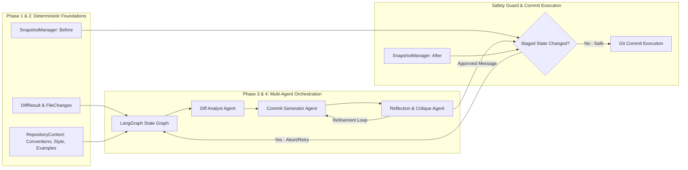

# GitCommit AI — Architecture Documentation

This document describes the design, system architecture, data flow, safety guarantees, and future AI integration points of **GitCommit AI**.

---

## 1. Architectural Philosophy

> **Core Principle**: *GitCommit AI must be deterministic and reliable at the repository-inspection and context-retrieval layers. AI orchestration and LLM inference will be built on top of this foundation, never mixed into it.*

Git operations (diff extraction, commit history analysis, working-tree inspection) and context engineering (normalization, statistical convention detection, style profiling, heuristic example selection) are deterministic system interactions with strict correctness and explainability requirements. By strictly decoupling these deterministic layers from the non-deterministic AI generation layer, GitCommit AI guarantees:

1. **Zero Unexpected Modifications**: The Git intelligence and context engine layers never modify, stage, unstage, or discard repository content.
2. **Subprocess Safety**: Command injection vulnerabilities are structurally eliminated through argument list passing without shell invocation.
3. **Structured Contracts**: All communication between system layers happens through typed Pydantic models rather than raw strings or unstructured dictionaries.
4. **Deterministic Context**: Commit conventions, writing style metrics, and historical examples are extracted using reproducible statistical algorithms and explainable scoring formulas, preventing LLM context pollution.
5. **Resilience to Race Conditions**: Working-tree snapshotting guarantees that if files change during AI generation, stale commit messages cannot be committed blindly.

---

## 2. Module Responsibilities

The codebase follows a `src`-based package layout (`src/git_commit_ai/`) divided into four cohesive packages:

```
src/git_commit_ai/
├── core/       # Foundational domain contracts, configuration, and errors
├── git/        # Deterministic Git intelligence & subprocess orchestration
├── context/    # Deterministic repository context engine & historical intelligence
└── cli/        # User-facing terminal interface
```

### A. Core Module (`git_commit_ai.core`)

Contains data structures and runtime configuration shared across all layers:

- **`schemas.py`**:
  - *Git Intelligence Schemas*:
    - `RepositoryInfo`: Metadata describing repo root, active branch, detached HEAD state, empty status, and categorized file lists (staged, unstaged, untracked).
    - `FileChange`: Granular change data for individual files (status, addition count, deletion count, binary flag, old path for renames/copies).
    - `DiffStatistics`: Aggregate change metrics (`files_changed`, `total_additions`, `total_deletions`).
    - `DiffResult`: Complete diff payload holding `raw_diff`, `file_changes`, `statistics`, and `mode`.
    - `HistoricalCommit`: Clean historical commit record containing `hash`, `subject`, and multiline `body`.
    - `RepositorySnapshot`: Immutable fingerprint containing `tree_hash`, `staged_files`, and timestamp for staleness checks.
    - `FileStatus` & `DiffMode`: `StrEnum` definitions enforcing domain type safety.
  - *Context Engine Schemas*:
    - `CommitConvention`: `StrEnum` covering `CONVENTIONAL`, `SCOPED_CONVENTIONAL`, `GITMOJI`, `BRACKET_PREFIXED`, `PLAIN`, and `UNKNOWN`.
    - `NormalizedCommit`: Decomposed commit message containing `hash`, `raw_subject`, `raw_body`, `type`, `scope`, `is_breaking`, `normalized_subject`, `normalized_body`, and `footers`.
    - `ConventionDetectionResult`: Statistical detection outcome containing `detected_convention`, `confidence`, `distribution`, `analyzed_commits`, and `supporting_evidence`.
    - `CommitTypeStatistics`: Counts of distinct commit types, most common type, and total count.
    - `CommitStyleProfile`: Granular writing style metrics including `average_subject_length`, `median_subject_length`, `typical_capitalization`, `punctuation_patterns`, `body_usage_frequency`, `scope_usage_frequency`, `common_scopes`, `type_frequencies`, `imperative_mood_frequency`, and `recent_convention_shifts`.
    - `HistoricalExample`: Contextual commit record containing `hash`, `subject`, `body`, `relevance_score`, `selection_reasons`, and `matched_files`.
    - `ExampleRetrievalResult`: Retrieval outcome containing `examples`, `query_files`, and `candidate_pool_size`.
    - `RepositoryContext`: Complete contextual envelope combining `convention_result`, `style_profile`, `historical_examples`, and `metadata`.
- **`config.py`**:
  - `GitCommitAIConfig`: Pydantic settings model validating command timeouts, default history counts, diff limits, and diff modes.
- **`exceptions.py`**:
  - Hierarchical domain exceptions rooted at `GitCommitAIError`:
    - `GitNotFoundError`: Git executable is not on `PATH`.
    - `NotAGitRepositoryError`: Provided directory is not inside a Git worktree.
    - `GitCommandError`: Subprocess exited with a non-zero exit code (captures `command`, `returncode`, `stderr`).
    - `GitTimeoutError`: Subprocess exceeded timeout threshold.
    - `EmptyRepositoryError`: Attempted an operation requiring commits on a fresh repository.

### B. Git Intelligence Module (`git_commit_ai.git`)

Implements all Git interactions using Python's `subprocess` standard library:

- **`repository.py` (`RepositoryInspector`)**:
  - Resolves absolute top-level directory (`git rev-parse --show-toplevel`).
  - Identifies active branch (`git symbolic-ref --short HEAD`) and detects detached HEAD.
  - Tracks staged files (`git diff --cached --name-only --diff-filter=ACDMRT`).
  - Tracks unstaged modifications (`git diff --name-only`).
  - Tracks untracked files (`git ls-files --others --exclude-standard`).
  - Handles repositories with zero commits.
- **`diff.py` (`DiffExtractor`)**:
  - Focuses by default strictly on **staged** changes (`DiffMode.STAGED`).
  - Captures raw unified diff with rename detection enabled (`-M`, `--no-color`).
  - Correlates addition/deletion counts from `git diff --numstat` with file statuses from `git diff --name-status`.
  - Resolves Git rename syntax (`old => new` and `{old => new}`) to identify original and destination paths.
  - Flags binary files without attempting lossy UTF-8 decoding.
- **`history.py` (`CommitHistoryExtractor`)**:
  - Extracts recent non-merge commits (`git log -n <count> --no-merges`).
  - Employs unique delimiters (`---GCAI_COMMIT_DELIM---` and `---GCAI_FIELD_DELIM---`) inside `--format` to parse multiline commit bodies and special characters reliably.
- **`snapshots.py` (`SnapshotManager`)**:
  - Computes the staged tree hash via `git write-tree` without creating a commit object.
  - Compares snapshots (`compare()`, `has_changed_since()`) to detect staged modifications occurring during execution.

### C. Repository Context Engine (`git_commit_ai.context`)

Analyzes historical repository patterns to derive deterministic context:

- **`normalizer.py` (`CommitNormalizer`)**:
  - Parses and standardizes diverse commit message formats into `NormalizedCommit` models.
  - Recognizes Conventional Commits syntax: `<type>(<scope>)?: <subject>`.
  - Recognizes bracket-prefixed patterns: `[<scope>] <subject>` or `[<type>] <subject>`.
  - Recognizes Gitmoji shortcodes (`:sparkles:`, `:bug:`) and unicode emojis (✨, 🐛), mapping them to standard semantic types.
  - Detects breaking changes from subject exclamation marks (`feat!: ...`) and `BREAKING CHANGE:` / `BREAKING-CHANGE:` body footers.
  - Cleans excess whitespace, leading issue/ticket references, and extracts footer tokens.
- **`convention_detector.py` (`CommitConventionDetector`)**:
  - Analyzes normalized historical commits to determine dominant repository convention.
  - Evaluates format distribution against configurable thresholds (e.g. $\ge 70\%$ scoped conventional, $\ge 60\%$ conventional).
  - Calculates confidence scores penalized for small sample sizes ($N < 5 \implies \text{confidence} \times 0.6$, $N < 10 \implies \text{confidence} \times 0.8$).
  - Produces detailed human-readable evidence strings supporting the detection decision.
- **`style_analyzer.py` (`RepositoryStyleAnalyzer`)**:
  - Measures subject length metrics: mean and median character lengths.
  - Evaluates subject capitalization: `lowercase`, `uppercase`, or `mixed`.
  - Analyzes punctuation patterns (e.g. trailing period detection).
  - Computes body usage frequency and scope usage frequency.
  - Identifies common repository scopes and frequency distributions across types.
  - Detects imperative mood usage via verb heuristic checks.
  - Detects temporal convention shifts by comparing the most recent 20% of commits against the older 80% baseline.
- **`example_selector.py` (`HistoricalExampleSelector`)**:
  - Implements a multi-factor heuristic scoring function matching staged changes against commit history:
    $$\text{Score}(H, \Delta) = \left(S_{\text{scope}} + S_{\text{path}} + S_{\text{type}} + S_{\text{keyword}}\right) \times \frac{1}{1 + \lambda \cdot \text{rank}}$$
    - **Scope Matching ($S_{\text{scope}} = 3.0$)**: Historical commit scope matches a top-level directory or file name in the diff.
    - **Path Matching ($S_{\text{path}} = 2.0$)**: Historical commit mentions a filename or directory path present in the diff.
    - **Type Matching ($S_{\text{type}} = 1.5$)**: Historical commit type matches the inferred diff change type (e.g., `feat`, `fix`, `test`, `docs`, `refactor`).
    - **Keyword Matching ($S_{\text{keyword}} = 0.5 \times \text{matches}$, max 1.5)**: Shared semantic keywords between commit subject/body and diff filenames.
    - **Recency Decay**: $\frac{1}{1 + \lambda \cdot \text{rank}}$ with $\lambda = 0.05$ prioritizes recent commits over older commits when scores are close.
  - Generates clear, explainable selection reasons for each retrieved example.
- **`engine.py` (`RepositoryContextEngine`)**:
  - Orchestrates the context pipeline (`build_context`) combining `DiffResult` and `list[HistoricalCommit]`.
  - Gracefully handles empty repositories by emitting safe defaults (`UNKNOWN` convention, zero-valued profile, empty examples).

### D. CLI Module (`git_commit_ai.cli`)

Builds the user-facing command-line tool using [Typer](https://typer.tiangolo.com/):

- `inspect`: Displays repository root, branch, detached HEAD status, and categorized file counts.
- `diff`: Displays staged (or unstaged via `--unstaged`) diff statistics and file change tables with status badges.
- `history`: Displays recent commit hashes and subjects with configurable `--count`.
- `context`: Analyzes and displays detected commit convention, confidence, style profile metrics, common types, common scopes, and evidence.
- `examples`: Retrieves and displays top historical commit examples matching staged or unstaged changes, complete with relevance scores, summaries, and selection reasons.
- Error handling maps all `GitCommitAIError` exceptions to clean terminal stderr messages and exit code 1.

---

## 3. Git Command Execution & Safety Strategy

To guarantee absolute safety, all Git interactions adhere to the following rules:

1. **No Shell Invocations**: `shell=True` is strictly forbidden. Commands are passed exclusively as lists of arguments (`["git", "-C", repo_path, "diff", ...]`).
2. **Deterministic Timeouts**: Every subprocess execution enforces a timeout (default 30 seconds via `GitCommitAIConfig.git_timeout_seconds`), preventing hung processes from indefinitely blocking execution.
3. **Stream Capture**: `stdout` and `stderr` are captured and decoupled. On failure, `stderr` is wrapped inside `GitCommandError` for debugging.
4. **No Destructive Operations**: The application never invokes `git add`, `git reset`, `git checkout`, `git rm`, or `git clean`. It is read-only with respect to repository files and the Git index.
5. **Safe Diff Fallbacks**: In newly initialized repositories (no commits yet), diffing the index compares cleanly against the unborn state without crashing.

---

## 4. System Data Flow

```mermaid
graph TD
    User([User / Terminal]) -->|CLI Command| CLI[git_commit_ai.cli]

    subgraph Git Intelligence Layer [git_commit_ai.git]
        Inspector[RepositoryInspector]
        DiffExt[DiffExtractor]
        HistoryExt[CommitHistoryExtractor]
        SnapMgr[SnapshotManager]
    end

    subgraph Context Engine [git_commit_ai.context]
        Normalizer[CommitNormalizer]
        ConvDetector[CommitConventionDetector]
        StyleAnalyzer[RepositoryStyleAnalyzer]
        Selector[HistoricalExampleSelector]
        ContextEngine[RepositoryContextEngine]
    end

    CLI --> Inspector
    CLI --> DiffExt
    CLI --> HistoryExt
    CLI --> SnapMgr
    CLI --> ContextEngine

    Inspector -->|Subprocess| GitCLI[(Git Engine)]
    DiffExt -->|Subprocess| GitCLI
    HistoryExt -->|Subprocess| GitCLI
    SnapMgr -->|Subprocess| GitCLI

    DiffExt -->|DiffResult| ContextEngine
    HistoryExt -->|list[HistoricalCommit]| ContextEngine

    ContextEngine --> Normalizer
    Normalizer -->|list[NormalizedCommit]| ConvDetector
    Normalizer -->|list[NormalizedCommit]| StyleAnalyzer
    Normalizer -->|list[NormalizedCommit]| Selector
    DiffExt -->|DiffResult| Selector

    ConvDetector -->|ConventionDetectionResult| ContextEngine
    StyleAnalyzer -->|CommitStyleProfile| ContextEngine
    Selector -->|list[HistoricalExample]| ContextEngine

    ContextEngine -->|RepositoryContext| CLI
    ContextEngine -->|RepositoryContext| FutureAgentState([Future LangGraph State])
```

---

## 5. Future AI Integration Points (Planned for Phase 3 & 4)

The clean abstraction boundaries established in Phase 1 and Phase 2 provide direct input payloads for **Phase 3 (LLM Integration)** and **Phase 4 (LangGraph Multi-Agent Orchestration)**:



### Planned AI Orchestration Components:

1. **State Graph (`git_commit_ai.orchestration.graph`)**:
   - Manages the agent state schema containing `diff_result`, `repository_context`, `proposed_messages`, `critique_feedback`, and `iteration_count`.
2. **Diff Analyst Agent**:
   - Decomposes file changes into logical units, distinguishes core logic from trivial edits/formatting, and detects breaking changes.
3. **Commit Generator Agent**:
   - Ingests `RepositoryContext` (detected convention, style profile constraints, and few-shot `historical_examples`) to generate candidate commit messages that blend seamlessly into the repository's existing history.
4. **Reflection & Critic Loop**:
   - Analyzes the generated message against the actual diff to catch hallucinations, fabricated file changes, or missing context. Loops back for regeneration if criteria are not met.
5. **Snapshot Staleness Check**:
   - Before prompting the user to commit or executing a commit, `SnapshotManager.has_changed_since(initial_snapshot)` verifies that the user did not modify staged changes during generation.

---

## 6. Implementation Status Matrix

| Component | Status | Details |
|---|---|---|
| Safe Git Subprocess Runner | **Implemented** | Argument lists, timeouts, stderr capture, custom exceptions |
| Repository Inspection | **Implemented** | Root resolution, branch name, detached HEAD, staged/unstaged/untracked |
| Diff Extraction | **Implemented** | Staged/unstaged, numstat parsing, name-status parsing, rename detection, binary file detection |
| Historical Commit Parser | **Implemented** | Configurable count, multiline bodies, special characters, non-merge filtering |
| Snapshot & Staleness Guard | **Implemented** | Staged tree hash capture (`git write-tree`), snapshot equality & staleness check |
| Domain Models & Config | **Implemented** | Pydantic v2 models, StrEnums, validated settings |
| Commit Normalizer | **Implemented** | Conventional Commits, scopes, breaking changes, bracket prefixes, Gitmoji |
| Convention Detector | **Implemented** | Statistical distribution, sample size confidence adjustments, evidence generation |
| Style Analyzer | **Implemented** | Subject length (mean/median), capitalization, punctuation, body/scope usage, shifts |
| Example Selector | **Implemented** | Multi-factor heuristic scoring (scope, path, type, keyword) with recency decay |
| Context Engine Orchestrator | **Implemented** | Complete deterministic pipeline assembling `RepositoryContext` |
| Extended CLI Commands | **Implemented** | `inspect`, `diff`, `history`, `context`, `examples` commands with colored output |
| Unit & Integration Tests | **Implemented** | 88 tests using isolated temporary Git fixtures (100% passing) |
| LLM Provider Abstraction | *Planned (Phase 3)* | OpenAI, Anthropic, Gemini, Ollama backends |
| Prompt Engineering & Few-Shot | *Planned (Phase 3)* | Context-driven few-shot prompt synthesis |
| LangGraph State Graph | *Planned (Phase 4)* | Multi-agent coordination and reflection loop |
| Interactive TUI / Git Hook | *Planned (Phase 5)* | Interactive review, editing, and `git-commit-ai` native subcommand |
