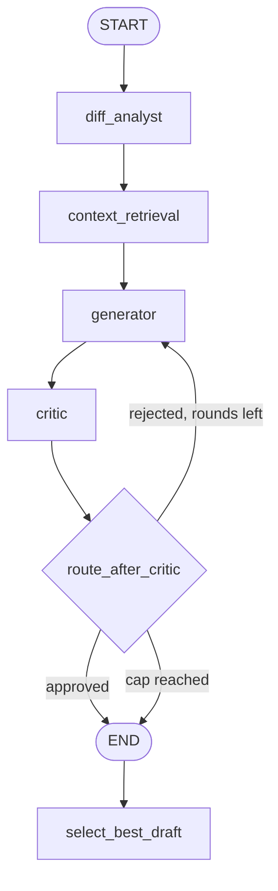
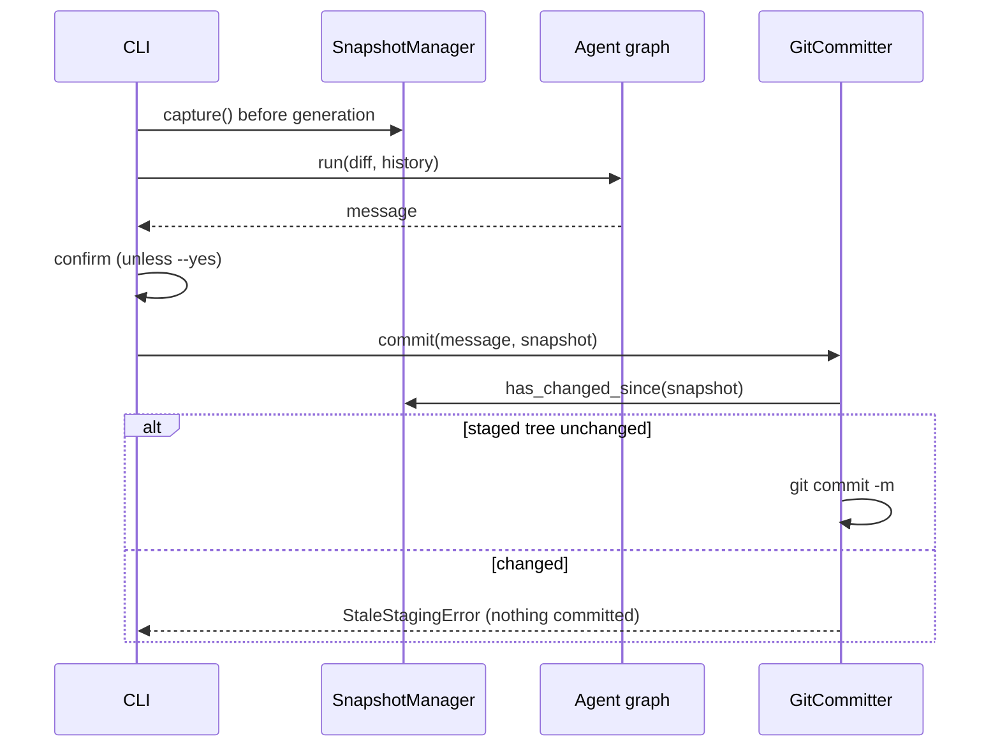

# GitCommit AI — Architecture Documentation

This document describes the design, system architecture, data flow, safety guarantees, and AI orchestration layer of **GitCommit AI**.

---

## 1. Architectural Philosophy

> **Core Principle**: *GitCommit AI must be deterministic and reliable at the repository-inspection and context-retrieval layers. AI orchestration and LLM inference will be built on top of this foundation, never mixed into it.*

Git operations (diff extraction, commit history analysis, working-tree inspection) and context engineering (normalization, statistical convention detection, style profiling, heuristic example selection) are deterministic system interactions with strict correctness and explainability requirements. By strictly decoupling these deterministic layers from the non-deterministic AI generation layer, GitCommit AI guarantees:

1. **Zero Unexpected Modifications**: The Git intelligence (inspection, diff, history, snapshots) and context engine layers never modify, stage, unstage, or discard repository content. The only writer is `GitCommitter`, which runs `git commit` on exactly what is already staged, and only after a staleness check.
2. **Subprocess Safety**: Command injection vulnerabilities are structurally eliminated through argument list passing without shell invocation.
3. **Structured Contracts**: All communication between system layers happens through typed Pydantic models rather than raw strings or unstructured dictionaries.
4. **Deterministic Context**: Commit conventions, writing style metrics, and historical examples are extracted using reproducible statistical algorithms and explainable scoring formulas, preventing LLM context pollution.
5. **Resilience to Race Conditions**: Working-tree snapshotting guarantees that if files change during AI generation, stale commit messages cannot be committed blindly.

---

## 2. Module Responsibilities

The codebase follows a `src`-based package layout (`src/git_commit_ai/`) divided into six cohesive packages with a strictly one-way dependency direction (`cli → agents → context → git/core`; `llm` is used by `agents` and the CLI):

```
src/git_commit_ai/
├── core/       # Foundational domain contracts, configuration, and errors
├── git/        # Deterministic Git intelligence & subprocess orchestration
├── context/    # Deterministic repository context engine & historical intelligence
├── llm/        # Provider-neutral LLM interface and backends
├── agents/     # LangGraph orchestration: analyst, generator, critic, reflection loop
└── cli/        # User-facing terminal interface
```

### A. Core Module (`git_commit_ai.core`)

Contains data structures and runtime configuration shared across all layers:

- **`schemas.py`**:
  - *Git Intelligence Schemas*:
    - `RepositoryInfo`: Metadata describing repo root, active branch, detached HEAD state, empty status, and categorized file lists (staged, unstaged, untracked).
    - `FileChange`: Granular change data for individual files (status, addition count, deletion count, binary flag, old path for renames/copies).
    - `DiffStatistics`: Aggregate change metrics (`files_changed`, `total_additions`, `total_deletions`).
    - `DiffResult`: Complete diff payload holding `raw_diff`, `file_changes`, `statistics`, and `mode`.
    - `HistoricalCommit`: Clean historical commit record containing `hash`, `subject`, and multiline `body`.
    - `RepositorySnapshot`: Immutable fingerprint containing `tree_hash`, `staged_files`, and timestamp for staleness checks.
    - `FileStatus` & `DiffMode`: `StrEnum` definitions enforcing domain type safety.
  - *Context Engine Schemas*:
    - `CommitConvention`: `StrEnum` covering `CONVENTIONAL`, `SCOPED_CONVENTIONAL`, `GITMOJI`, `BRACKET_PREFIX`, `PLAIN`, and `UNKNOWN`.
    - `NormalizedCommit`: Decomposed commit message containing `hash`, `raw_subject`, `raw_body`, `type`, `scope`, `is_breaking`, `normalized_subject`, `normalized_body`, and `footers`.
    - `ConventionDetectionResult`: Statistical detection outcome containing `detected_convention`, `confidence`, `distribution`, `analyzed_commits`, and `supporting_evidence`.
    - `CommitTypeStatistics`: Counts of distinct commit types, most common type, and total count.
    - `CommitStyleProfile`: Granular writing style metrics including `average_subject_length`, `median_subject_length`, `typical_capitalization`, `punctuation_patterns`, `body_usage_frequency`, `scope_usage_frequency`, `common_scopes`, `type_frequencies`, `imperative_mood_frequency`, and `recent_convention_shifts`.
    - `HistoricalExample`: Contextual commit record containing `hash`, `subject`, `body`, `relevance_score`, `selection_reasons`, and `matched_files`.
    - `ExampleRetrievalResult`: Retrieval outcome containing `examples`, `query_files`, and `candidate_pool_size`.
    - `RepositoryContext`: Complete contextual envelope combining `convention_result`, `style_profile`, `historical_examples`, and `metadata`.
- **`config.py`**:
  - `GitCommitAIConfig`: Pydantic settings model validating command timeouts, default history counts, diff limits, and diff modes, plus LLM provider, model, temperature, timeout, Ollama URL, `max_iterations` (1–10), and the prompt diff budget (`max_prompt_diff_chars`).
  - `GitCommitAIConfig.from_env()`: builds the configuration from `GITCOMMIT_AI_*` variables and reports the offending variable name on invalid values (`ConfigurationError`).
  - `ProviderName`: `StrEnum` of the supported backends.
  - API keys are deliberately **not** part of the configuration; they are read from the environment when a provider is created, so they never appear in reprs or logs.
- **`exceptions.py`**:
  - Hierarchical domain exceptions rooted at `GitCommitAIError`:
    - `GitNotFoundError`: Git executable is not on `PATH`.
    - `NotAGitRepositoryError`: Provided directory is not inside a Git worktree.
    - `GitCommandError`: Subprocess exited with a non-zero exit code (captures `command`, `returncode`, `stderr`).
    - `GitTimeoutError`: Subprocess exceeded timeout threshold.
    - `EmptyRepositoryError`: Attempted an operation requiring commits on a fresh repository.
    - `StaleStagingError`: The staged tree changed between analysis and commit.
    - `ConfigurationError`: An environment variable or setting is invalid.
    - `AgentStateError`: A graph node ran before its upstream data existed.
    - `LLMError` and subclasses: `MissingAPIKeyError`, `ProviderNotInstalledError`, `OllamaUnreachableError`, `RateLimitError` (carries `retry_after` when the server sent one), `LLMResponseError`.

### B. Git Intelligence Module (`git_commit_ai.git`)

Implements all Git interactions using Python's `subprocess` standard library:

- **`repository.py` (`RepositoryInspector`)**:
  - Resolves absolute top-level directory (`git rev-parse --show-toplevel`).
  - Identifies active branch (`git symbolic-ref --short HEAD`) and detects detached HEAD.
  - Tracks staged files (`git diff --cached --name-only --diff-filter=ACDMRT`).
  - Tracks unstaged modifications (`git diff --name-only`).
  - Tracks untracked files (`git ls-files --others --exclude-standard`).
  - Handles repositories with zero commits.
- **`diff.py` (`DiffExtractor`)**:
  - Focuses by default strictly on **staged** changes (`DiffMode.STAGED`).
  - Captures raw unified diff with rename detection enabled (`-M`, `--no-color`).
  - Correlates addition/deletion counts from `git diff --numstat` with file statuses from `git diff --name-status`.
  - Resolves Git rename syntax (`old => new` and `{old => new}`) to identify original and destination paths.
  - Flags binary files without attempting lossy UTF-8 decoding.
- **`history.py` (`CommitHistoryExtractor`)**:
  - Extracts recent non-merge commits (`git log -n <count> --no-merges`).
  - Employs unique delimiters (`---GCAI_COMMIT_DELIM---` and `---GCAI_FIELD_DELIM---`) inside `--format` to parse multiline commit bodies and special characters reliably.
- **`snapshots.py` (`SnapshotManager`)**:
  - Computes the staged tree hash via `git write-tree` without creating a commit object.
  - Compares snapshots (`compare()`, `has_changed_since()`) to detect staged modifications occurring during execution.
- **`committer.py` (`GitCommitter`)**:
  - The only component that writes to the repository. `commit(message, expected_snapshot)` raises `StaleStagingError` if the staged tree no longer matches the snapshot taken before generation; otherwise it runs `git commit -m` (hooks run as usual) and returns the short hash.
  - It never stages or unstages anything. A very small window remains between the staleness check and the commit itself; closing it fully would need a lock Git does not offer for the index.

### C. Repository Context Engine (`git_commit_ai.context`)

Analyzes historical repository patterns to derive deterministic context:

- **`normalizer.py` (`CommitNormalizer`)**:
  - Parses and standardizes diverse commit message formats into `NormalizedCommit` models.
  - Recognizes Conventional Commits syntax: `<type>(<scope>)?: <subject>`.
  - Recognizes bracket-prefixed patterns: `[<scope>] <subject>` or `[<type>] <subject>`.
  - Recognizes Gitmoji shortcodes (`:sparkles:`, `:bug:`) and unicode emojis (✨, 🐛), mapping them to standard semantic types.
  - Detects breaking changes from subject exclamation marks (`feat!: ...`) and `BREAKING CHANGE:` / `BREAKING-CHANGE:` body footers.
  - Cleans excess whitespace, leading issue/ticket references, and extracts footer tokens.
- **`convention_detector.py` (`CommitConventionDetector`)**:
  - Analyzes normalized historical commits to determine dominant repository convention.
  - Evaluates format distribution against configurable thresholds (e.g. $\ge 70\%$ scoped conventional, $\ge 60\%$ conventional).
  - Calculates confidence scores penalized for small sample sizes ($N < 5 \implies \text{confidence} \times 0.6$, $N < 10 \implies \text{confidence} \times 0.8$).
  - Produces detailed human-readable evidence strings supporting the detection decision.
- **`style_analyzer.py` (`RepositoryStyleAnalyzer`)**:
  - Measures subject length metrics: mean and median character lengths.
  - Evaluates subject capitalization: `lowercase`, `uppercase`, or `mixed`.
  - Analyzes punctuation patterns (e.g. trailing period detection).
  - Computes body usage frequency and scope usage frequency.
  - Identifies common repository scopes and frequency distributions across types.
  - Detects imperative mood usage via verb heuristic checks.
  - Detects temporal convention shifts by comparing the most recent 20% of commits against the older 80% baseline.
- **`example_selector.py` (`HistoricalExampleSelector`)**:
  - Implements a multi-factor heuristic scoring function matching staged changes against commit history:
    $$\text{Score}(H, \Delta) = \left(S_{\text{scope}} + S_{\text{path}} + S_{\text{type}} + S_{\text{keyword}}\right) \times \frac{1}{1 + \lambda \cdot \text{rank}}$$
    - **Scope Matching ($S_{\text{scope}} = 3.0$)**: Historical commit scope matches a top-level directory or file name in the diff.
    - **Path Matching ($S_{\text{path}} = 2.0$)**: Historical commit mentions a filename or directory path present in the diff.
    - **Type Matching ($S_{\text{type}} = 1.5$)**: Historical commit type matches the inferred diff change type (e.g., `feat`, `fix`, `test`, `docs`, `refactor`).
    - **Keyword Matching ($S_{\text{keyword}} = 0.5 \times \text{matches}$, max 1.5)**: Shared semantic keywords between commit subject/body and diff filenames.
    - **Recency Decay**: $\frac{1}{1 + \lambda \cdot \text{rank}}$ with $\lambda = 0.05$ prioritizes recent commits over older commits when scores are close.
  - Generates clear, explainable selection reasons for each retrieved example.
- **`engine.py` (`RepositoryContextEngine`)**:
  - Orchestrates the context pipeline (`build_context`) combining `DiffResult` and `list[HistoricalCommit]`.
  - Gracefully handles empty repositories by emitting safe defaults (`UNKNOWN` convention, zero-valued profile, empty examples).

### D. CLI Module (`git_commit_ai.cli`)

Builds the user-facing command-line tool using [Typer](https://typer.tiangolo.com/):

- `inspect`: Displays repository root, branch, detached HEAD status, and categorized file counts.
- `diff`: Displays staged (or unstaged via `--unstaged`) diff statistics and file change tables with status badges.
- `history`: Displays recent commit hashes and subjects with configurable `--count`.
- `context`: Analyzes and displays detected commit convention, confidence, style profile metrics, common types, common scopes, and evidence.
- `examples`: Retrieves and displays top historical commit examples matching staged or unstaged changes, complete with relevance scores, summaries, and selection reasons.
- `generate`: runs the agent graph on the staged diff (see §5), prints the message to stdout, and commits after confirmation. Flags: `--provider`, `--model`, `--dry-run`, `--yes`, `--max-iterations`, `--verbose`, `--path`. Diagnostics go to stderr.
- `git-ai-commit` console script: runs `generate` directly so `git ai-commit` works (git finds `git-<name>` executables on `PATH`). It also accepts `-h`, because git intercepts `--help` for external commands.
- Error handling maps all `GitCommitAIError` exceptions to clean terminal stderr messages and exit code 1.

### E. LLM Module (`git_commit_ai.llm`)

- **`base.py`**: `LLMMessage`/`Role` and the `LLMProvider` protocol: `name`, `model`, and `complete(messages) -> str`. The protocol is deliberately text-in/text-out; structured replies are layered on top by `agents.llm_json`.
- **`factory.py`**: `create_provider(config, env)` picks the backend, resolves the model (explicit or provider default), and reads the API key from the environment. Backend modules are imported lazily, so a missing optional SDK only affects the provider that needs it (`ProviderNotInstalledError` names the extra to install).
- **Backends** (`openai_provider.py`, `anthropic_provider.py`, `gemini_provider.py`, `ollama_provider.py`): thin wrappers over the official SDKs. Each translates SDK failures into typed errors and rejects empty completions. Anthropic and Gemini receive the system prompt out of band.
- **`fake.py`**: `FakeLLM` replays a scripted sequence or a handler callable and records calls. An exhausted sequence raises rather than reusing a reply, so tests cannot silently pass on stale data.

### F. Agents Module (`git_commit_ai.agents`)

See §5.

---

## 3. Git Command Execution & Safety Strategy

To guarantee absolute safety, all Git interactions adhere to the following rules:

1. **No Shell Invocations**: `shell=True` is strictly forbidden. Commands are passed exclusively as lists of arguments (`["git", "-C", repo_path, "diff", ...]`).
2. **Deterministic Timeouts**: Every subprocess execution enforces a timeout (default 30 seconds via `GitCommitAIConfig.git_timeout_seconds`), preventing hung processes from indefinitely blocking execution.
3. **Stream Capture**: `stdout` and `stderr` are captured and decoupled. On failure, `stderr` is wrapped inside `GitCommandError` for debugging.
4. **No Destructive Operations**: The application never invokes `git add`, `git reset`, `git checkout`, `git rm`, or `git clean`. Everything is read-only with respect to repository files and the Git index except one operation: `GitCommitter` runs `git commit` on what is already staged, after a staleness check, and only when the user confirmed (or passed `--yes`).
5. **Safe Diff Fallbacks**: In newly initialized repositories (no commits yet), diffing the index compares cleanly against the unborn state without crashing.

---

## 4. System Data Flow

```mermaid
graph TD
    User([User / Terminal]) -->|CLI Command| CLI[git_commit_ai.cli]

    subgraph Git Intelligence Layer [git_commit_ai.git]
        Inspector[RepositoryInspector]
        DiffExt[DiffExtractor]
        HistoryExt[CommitHistoryExtractor]
        SnapMgr[SnapshotManager]
    end

    subgraph Context Engine [git_commit_ai.context]
        Normalizer[CommitNormalizer]
        ConvDetector[CommitConventionDetector]
        StyleAnalyzer[RepositoryStyleAnalyzer]
        Selector[HistoricalExampleSelector]
        ContextEngine[RepositoryContextEngine]
    end

    CLI --> Inspector
    CLI --> DiffExt
    CLI --> HistoryExt
    CLI --> SnapMgr
    CLI --> ContextEngine

    Inspector -->|Subprocess| GitCLI[(Git Engine)]
    DiffExt -->|Subprocess| GitCLI
    HistoryExt -->|Subprocess| GitCLI
    SnapMgr -->|Subprocess| GitCLI

    DiffExt -->|DiffResult| ContextEngine
    HistoryExt -->|list[HistoricalCommit]| ContextEngine

    ContextEngine --> Normalizer
    Normalizer -->|list[NormalizedCommit]| ConvDetector
    Normalizer -->|list[NormalizedCommit]| StyleAnalyzer
    Normalizer -->|list[NormalizedCommit]| Selector
    DiffExt -->|DiffResult| Selector

    ConvDetector -->|ConventionDetectionResult| ContextEngine
    StyleAnalyzer -->|CommitStyleProfile| ContextEngine
    Selector -->|list[HistoricalExample]| ContextEngine

    ContextEngine -->|RepositoryContext| CLI
    ContextEngine -->|RepositoryContext| AgentGraph([agents: LangGraph state])
```

The agent graph that consumes these results is described in §5.

---

## 5. AI Orchestration (Phase 3)

LLM calls happen only inside `git_commit_ai.agents`. Everything the agents consume (`DiffResult`, `RepositoryContext`) comes from the deterministic layers, and the CLI does all Git access, so the graph itself never touches Git.



### State (`agents/state.py`)

`AgentState` is a Pydantic model; every node returns only the fields it changed.

| Field | Written by | Meaning |
|---|---|---|
| `diff_result`, `history` | caller | Staged diff and extracted commits (inputs) |
| `diff_digest` | diff_analyst | Prompt-sized diff text, with `was_truncated` and `omitted_files` |
| `analysis` | diff_analyst | `DiffAnalysis`: change type, summary, intent, breaking flag, scope hint |
| `context` | context_retrieval | `RepositoryContext` from the context engine |
| `drafts` | generator, critic | `Draft`s: message, iteration, and the critic's `Critique` |
| `iteration` | generator | Completed generation rounds |

A `Critique` is a list of `Violation(rule, message, severity)`. A draft is **approved** when it has no error-level violations; warnings are advisory. `penalty` weights errors 10 and warnings 1 and is used to rank drafts.

### Node contracts

| Node | LLM? | Reads | Writes |
|---|---|---|---|
| `diff_analyst` | yes | `diff_result` | `diff_digest`, `analysis` |
| `context_retrieval` | no | `diff_result`, `history` | `context` |
| `generator` | yes | digest, analysis, context, previous draft + critique | appends a `Draft`, increments `iteration` |
| `critic` | only if no rule error | digest, analysis, context, latest draft | replaces the latest draft with a reviewed copy |

Nodes are built by factories (`make_generator(llm)`, ...) and typed with the `AgentNode` protocol, so each can be unit-tested with a `FakeLLM` and no graph. A node that runs before its inputs exist raises `AgentStateError`.

### Diff budget (`agents/diff_budget.py`)

Large diffs are never sent whole. The file summary (status, path, rename origin, `+/-` counts, binary flag) is always included. The remaining character budget (`max_prompt_diff_chars`, default 24 000) is shared across patches by water-filling: small patches are kept whole and the space they leave unused goes to larger ones, which are truncated at a line boundary with a `... [N more lines truncated]` marker. A patch that would get fewer than 200 characters is dropped and its file is listed by name only. Binary files never contribute patch text. The same digest is stored in state, so the generator and critic see exactly what the analyst saw, and the critic is told when it is truncated so it does not call unseen changes invented.

### Generator prompt (`agents/generator.py`)

The prompt is built from deterministic context, not a fixed template:

- **Format rule** from the detected convention (conventional, scoped, gitmoji, bracket prefix, plain). With no usable history (`UNKNOWN`) the default is Conventional Commits (`agents/conventions.py`, shared with the critic so both agree).
- **Style rules** from the profile: capitalization, trailing period, subject length (hard limit 72), imperative mood, body habit, and the breaking-change footer when the analyst flags a break.
- **Few-shot examples**: the retrieved historical commits, verbatim.
- **Revision context**: on later rounds, the previous draft and the critic's violations.

### Critic (`agents/critic_rules.py`, `agents/critic.py`)

Deterministic rules decide everything a rule can decide:

| Rule | Severity | Checks |
|---|---|---|
| `format` | error | Prefix matches the convention; known type; description present |
| `scope` | error / warning | Scope present when the repo always scopes (error); scope never seen before (warning) |
| `subject-length` | error / warning | Over 72 characters (error); much longer than the repo average (warning) |
| `imperative-mood` | error | Past, gerund or third-person form of a known verb; only enforced where the repo is imperative |
| `capitalization` | error | Matches the repo's typical capitalization |
| `trailing-period` | error | Matches the repo's punctuation habit |
| `breaking-change` | error / warning | Breaking change unmarked (error); marked but not breaking (warning) |
| `type-mismatch` | warning | Draft type differs from the analyst's |
| `body` | warning | Body presence against the repo's habit |
| `blank-line` | warning | Blank line between subject and body |

Only when no rule raised an error does the critic spend one LLM call on **faithfulness** (does the message claim changes that are not in the diff, or miss the main one?). A draft that must be rewritten anyway does not need that verdict yet. If the verdict cannot be parsed after one corrective retry, a non-blocking `faithfulness-unchecked` warning is recorded instead of failing the run.

### Reflection loop and termination (`agents/graph.py`)

`route_after_critic` is a pure function: stop when the latest draft is approved, and unconditionally when `iteration >= max_iterations`; otherwise regenerate. The LangGraph recursion limit is derived from the same cap, so the framework guard can never fire before the configured one. When no draft is approved, `select_best_draft` returns the draft with the lowest penalty, preferring the latest on ties (it has seen the most feedback); an unreviewed draft ranks below any reviewed one. The result carries `approved=False`, and the CLI shows the remaining issues.

### Structured replies (`agents/llm_json.py`)

`complete_json` extracts the outermost JSON object from a reply (tolerating prose and code fences), validates it against a Pydantic model, and feeds the validation error back for one corrective retry. Small local models often fail the first attempt this way; a second failure raises `LLMResponseError`.

### Staleness guard



### Design decisions

- **Rules before the LLM**: anything checkable deterministically is, which makes critic behavior reproducible and cheap, and keeps the LLM for the one question rules cannot answer.
- **One shared definition of "correct"**: generator and critic both use `effective_convention`, and the imperative verb list is a single public constant of the style analyzer.
- **Graceful degradation over failure**: an unparsable faithfulness verdict becomes a warning, and an exhausted iteration budget returns the best draft. Provider failures (missing key, rate limit, unreachable Ollama) do propagate, because retrying cannot fix them.
- **Optional SDKs**: only `langgraph` is a core dependency; provider SDKs are extras imported lazily.
- **`.env` is not loaded**: avoids another dependency and implicit behavior; `.env.example` documents the variables to export.

---

## 6. Implementation Status Matrix

| Component | Status | Details |
|---|---|---|
| Safe Git Subprocess Runner | **Implemented** | Argument lists, timeouts, stderr capture, custom exceptions |
| Repository Inspection | **Implemented** | Root resolution, branch name, detached HEAD, staged/unstaged/untracked |
| Diff Extraction | **Implemented** | Staged/unstaged, numstat parsing, name-status parsing, rename detection, binary file detection |
| Historical Commit Parser | **Implemented** | Configurable count, multiline bodies, special characters, non-merge filtering |
| Snapshot & Staleness Guard | **Implemented** | Staged tree hash capture (`git write-tree`), snapshot equality & staleness check |
| Staleness-Guarded Committer | **Implemented** | `GitCommitter`: refuses to commit if the staged tree changed since analysis |
| Domain Models & Config | **Implemented** | Pydantic v2 models, StrEnums, validated settings, `from_env()` |
| Commit Normalizer | **Implemented** | Conventional Commits, scopes, breaking changes, bracket prefixes, Gitmoji |
| Convention Detector | **Implemented** | Statistical distribution, sample size confidence adjustments, evidence generation |
| Style Analyzer | **Implemented** | Subject length (mean/median), capitalization, punctuation, body/scope usage, shifts |
| Example Selector | **Implemented** | Multi-factor heuristic scoring (scope, path, type, keyword) with recency decay |
| Context Engine Orchestrator | **Implemented** | Complete deterministic pipeline assembling `RepositoryContext` |
| LLM Provider Abstraction | **Implemented** | OpenAI, Anthropic, Gemini, Ollama behind one protocol; typed errors; `FakeLLM` |
| Prompt Engineering & Few-Shot | **Implemented** | Convention- and profile-driven prompts with retrieved examples and critic feedback |
| LangGraph State Graph | **Implemented** | Analyst, retrieval, generator, critic nodes; capped reflection loop with best-draft fallback |
| Diff Budgeting | **Implemented** | Water-filled per-file truncation; binary files summarised without patches |
| CLI Commands | **Implemented** | `inspect`, `diff`, `history`, `context`, `examples`, `generate`; `git ai-commit` entry point |
| Unit & Integration Tests | **Implemented** | 263 tests using isolated temporary Git repositories and `FakeLLM`; no network |
| Interactive TUI | *Planned (Phase 4)* | Interactive review and editing of the proposed message |
