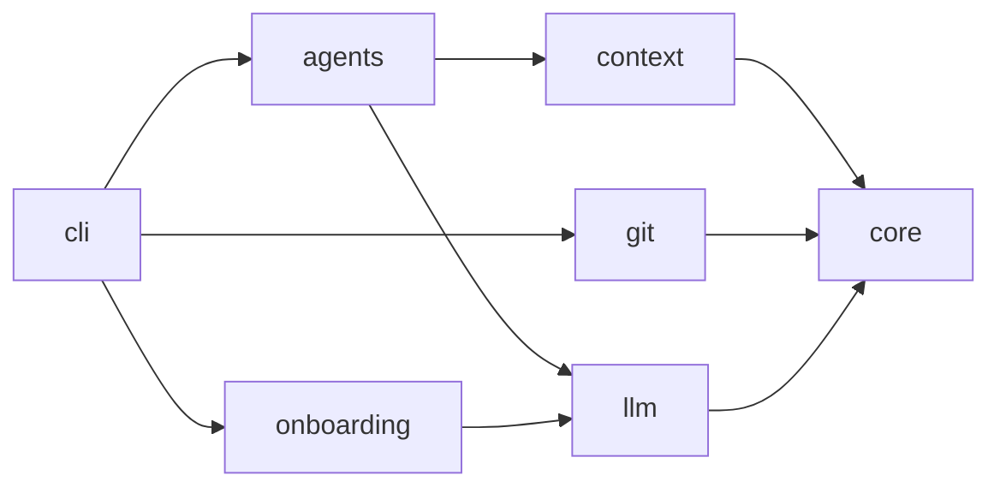
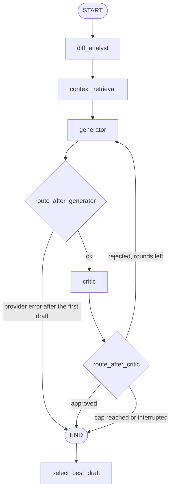
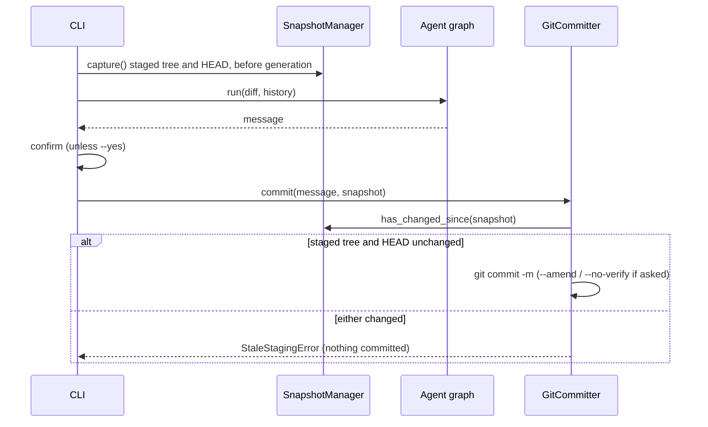

# GitCommit AI — Architecture Documentation

This document describes the design, system architecture, data flow, safety guarantees, and AI orchestration layer of **GitCommit AI**.

---

## 1. Architectural Philosophy

> **Core Principle**: *GitCommit AI must be deterministic and reliable at the repository-inspection and context-retrieval layers. AI orchestration and LLM inference will be built on top of this foundation, never mixed into it.*

Git operations (diff extraction, commit history analysis, working-tree inspection) and context engineering (normalization, statistical convention detection, style profiling, heuristic example selection) are deterministic system interactions with strict correctness and explainability requirements. By strictly decoupling these deterministic layers from the non-deterministic AI generation layer, GitCommit AI guarantees:

1. **Zero Unexpected Modifications**: The Git intelligence (inspection, diff, history, snapshots) and context engine layers never modify, stage, unstage, or discard repository content. The only writer is `GitCommitter`, which runs `git commit` on exactly what is already staged, and only after a staleness check.
2. **Subprocess Safety**: Command injection vulnerabilities are structurally eliminated through argument list passing without shell invocation.
3. **Structured Contracts**: All communication between system layers happens through typed Pydantic models rather than raw strings or unstructured dictionaries.
4. **Deterministic Context**: Commit conventions, writing style metrics, and historical examples are extracted using reproducible statistical algorithms and explainable scoring formulas, preventing LLM context pollution.
5. **Resilience to Race Conditions**: Working-tree snapshotting guarantees that if files change during AI generation, stale commit messages cannot be committed blindly.

---

## 2. Module Responsibilities

The codebase follows a `src`-based package layout (`src/git_commit_ai/`) divided into six cohesive packages with a strictly one-way dependency direction. The graph below is the import graph as it stands (implied edges are left out). `tests/unit/test_layers.py` fails if a module imports against it, and `scripts/check_docs.py` fails if this diagram or the README's stops matching the code:



(The CLI also imports `context`, `core` and `llm` directly: it builds the provider and prints the deterministic reports. `agents` never imports `git`, and nothing below `cli` imports it. `onboarding`, the setup wizard, imports only `llm` and `core`.)

```
src/git_commit_ai/
├── core/       # Foundational domain contracts, configuration, and errors
├── git/        # Deterministic Git intelligence & subprocess orchestration
├── context/    # Deterministic repository context engine & historical intelligence
├── llm/        # Provider-neutral LLM interface and backends
├── agents/     # LangGraph orchestration: analyst, generator, critic, reflection loop
└── cli/        # User-facing terminal interface
```

Outside the package, `scripts/` holds developer tooling that is not installed (see §2G).

### A. Core Module (`git_commit_ai.core`)

Contains data structures and runtime configuration shared across all layers:

- **`schemas.py`** (every field below is generated from the models, so it matches the code):
  - *Git Intelligence Schemas*:
    - `RepositoryInfo`: Snapshot of repository-level metadata. Fields: `root_path`, `branch`, `is_detached_head`, `is_empty`, `operation`, `staged_files`, `unstaged_files`, `untracked_files`.
    - `FileChange`: Per-file change information from a diff. Fields: `path`, `status`, `additions`, `deletions`, `is_binary`, `old_path`.
    - `DiffStatistics`: Aggregate statistics for a diff. Fields: `files_changed`, `total_additions`, `total_deletions`.
    - `DiffResult`: Complete diff output including raw diff, per-file changes, and statistics. Fields: `raw_diff`, `file_changes`, `statistics`, `mode`.
    - `HistoricalCommit`: Metadata for a single historical commit. Fields: `hash`, `subject`, `body`.
    - `RepositorySnapshot`: Snapshot of the staged tree identity for staleness detection. Fields: `tree_hash`, `head_hash`, `staged_files`, `timestamp`.
    - `FileStatus`: `StrEnum`. Status of a file in the Git working tree or index. Members: `ADDED`, `MODIFIED`, `DELETED`, `RENAMED`, `COPIED`, `UNTRACKED`, `TYPE_CHANGED`.
    - `DiffMode`: `StrEnum`. Which changes to diff. Members: `STAGED`, `UNSTAGED`, `AMEND`.
    - `RepositoryOperation`: `StrEnum`. A multi-step Git operation that is paused and waiting for a commit. Members: `NONE`, `MERGE`, `REBASE`, `CHERRY_PICK`, `REVERT`.
  - *Context Engine Schemas*:
    - `CommitConvention`: `StrEnum`. Categorization of commit message convention. Members: `CONVENTIONAL`, `SCOPED_CONVENTIONAL`, `GITMOJI`, `BRACKET_PREFIX`, `PLAIN`, `UNKNOWN`.
    - `NormalizedCommit`: Normalized metadata extracted from a historical commit. Fields: `hash`, `original_subject`, `original_body`, `cleaned_subject`, `cleaned_body`, `convention`, `commit_type`, `scope`, `is_breaking`, `breaking_description`, `gitmoji`, `bracket_prefix`.
    - `ConventionDetectionResult`: Statistical summary of repository-level commit convention analysis. Fields: `detected_convention`, `confidence`, `supporting_evidence`, `analyzed_commits`, `format_distribution`.
    - `CommitTypeStatistics`: Frequency metrics for a specific commit type. Fields: `type_name`, `count`, `percentage`, `breaking_count`.
    - `CommitStyleProfile`: Structured stylistic profile of repository commit habits. Fields: `dominant_convention`, `type_frequencies`, `scope_usage_frequency`, `common_scopes`, `average_subject_length`, `median_subject_length`, `typical_capitalization`, `punctuation_patterns`, `imperative_mood_frequency`, `body_usage_frequency`, `breaking_change_frequency`, `recent_convention_shifts`.
    - `HistoricalExample`: Selected historical commit recommended as few-shot context. Fields: `hash`, `subject`, `body`, `original_message`, `relevance_score`, `selection_reasons`, `matched_scope`, `matched_type`.
    - `ExampleRetrievalResult`: Result of historical example selection. Fields: `examples`, `total_candidates`, `selection_metadata`.
    - `RepositoryContext`: Aggregated repository context bundle for consumption by AI generators. Fields: `style_profile`, `convention_result`, `historical_examples`, `analyzed_commit_count`, `retrieval_metadata`.
- **`config.py`**:
  - `GitCommitAIConfig`: Pydantic settings model. Fields: `history_commit_count`, `git_timeout_seconds`, `default_diff_mode`, `max_diff_size_bytes`, `llm_provider`, `llm_model`, `llm_temperature`, `llm_timeout_seconds`, `llm_max_retries`, `llm_retry_base_delay_seconds`, `llm_retry_max_delay_seconds`, `ollama_base_url`, `max_iterations` (1–10), `max_prompt_diff_chars`. The retry base delay may not exceed the max delay.
  - `GitCommitAIConfig.from_env()` and `ENV_FIELDS`: map `GITCOMMIT_AI_*` variables to fields; an invalid value raises `ConfigurationError` naming the variable.
  - `ProviderName`: `StrEnum` of the supported backends.
  - API keys are deliberately **not** part of the configuration; they are read from the environment when a provider is created, so they never appear in reprs or logs.
- **`settings.py`**:
  - `load_settings(env, start_dir, repo_root)` layers **flags > process environment > `.env` > defaults** and returns a `Settings` that also records where each value came from (`SettingSource`: flag, environment, `.env`, default).
  - The `.env` file is looked for in exactly two places: `start_dir` (the current directory) and then `repo_root`. Nothing else is searched: not parent directories, not the directories between the two, not the home directory, so a stray `.env` elsewhere cannot change the configuration. `core` knows nothing about Git, so the CLI resolves the root (`cli/settings_loader.py`, via `RepositoryInspector.find_repository_root()`); outside a repository, or without Git, only the current directory is searched. The file is parsed with `python-dotenv` into a dict. It is **never** written into `os.environ`, so its values cannot leak into child processes. `GITCOMMIT_AI_ENV_FILE` names a specific file, or disables loading when empty. Blank values count as unset at every layer.
  - `Settings.with_flags()` applies command-line flags on top (a flag left unset does not override anything); `mask_secret()` keeps only the last four characters of a secret.
- **`exceptions.py`**:
  - Hierarchical domain exceptions rooted at `GitCommitAIError`:
    - `GitNotFoundError`: Git executable is not on `PATH`.
    - `NotAGitRepositoryError`: Provided directory is not inside a Git worktree.
    - `GitCommandError`: Subprocess exited with a non-zero exit code (captures `command`, `returncode`, `stderr`).
    - `GitTimeoutError`: Subprocess exceeded timeout threshold.
    - `EmptyRepositoryError`: Attempted an operation requiring commits on a fresh repository.
    - `StaleStagingError`: The staged tree changed between analysis and commit.
    - `ConfigurationError`: An environment variable or setting is invalid.
    - `AgentStateError`: A graph node ran before its upstream data existed.
    - `HookError`: The prepare-commit-msg hook cannot be installed or removed safely.
    - `LLMError` and subclasses: `MissingAPIKeyError`, `ProviderNotInstalledError`, `OllamaUnreachableError`, `RateLimitError` (carries `retry_after` when the server sent one), `TransientLLMError` (timeouts, dropped connections, 5xx; retried), `LLMResponseError`.

### B. Git Intelligence Module (`git_commit_ai.git`)

Implements all Git interactions using Python's `subprocess` standard library:

- **`repository.py` (`RepositoryInspector`)**:
  - Resolves absolute top-level directory (`git rev-parse --show-toplevel`).
  - Identifies active branch (`git symbolic-ref --short HEAD`) and detects detached HEAD.
  - Tracks staged files (`git diff --cached --name-only --diff-filter=ACDMRT`).
  - Tracks unstaged modifications (`git diff --name-only`).
  - Tracks untracked files (`git ls-files --others --exclude-standard`).
  - Handles repositories with zero commits.
  - Detects a paused merge, rebase, cherry-pick or revert (`get_operation_in_progress()`, reported as `RepositoryInfo.operation`) from Git's own marker files via `--git-path`, so linked worktrees work.
  - Asks Git for the empty-tree hash (`git hash-object -t tree /dev/null`, nothing is written) instead of hard-coding it, which also covers SHA-256 repositories.
- **`diff.py` (`DiffExtractor`)**:
  - Focuses by default strictly on **staged** changes (`DiffMode.STAGED`). `DiffMode.AMEND` diffs the index against `HEAD`'s parent (the empty tree for a root commit): what `git commit --amend` would produce.
  - Captures raw unified diff with rename detection enabled (`-M`, `--no-color`).
  - Correlates addition/deletion counts from `git diff --numstat` with file statuses from `git diff --name-status`.
  - Resolves Git rename syntax (`old => new` and `{old => new}`) to identify original and destination paths.
  - Flags binary files without attempting lossy UTF-8 decoding.
- **`history.py` (`CommitHistoryExtractor`)**:
  - Extracts recent non-merge commits (`git log -n <count> --no-merges`). `exclude_head=True` starts at the parent of `revision` (`HEAD` by default), so a commit being amended is not offered as an example of itself. `revision` sets where the walk starts, which lets the evaluation harness show the generator only what was older than a replayed commit.
  - Employs unique delimiters (`---GCAI_COMMIT_DELIM---` and `---GCAI_FIELD_DELIM---`) inside `--format` to parse multiline commit bodies and special characters reliably.
- **`snapshots.py` (`SnapshotManager`)**:
  - Computes the staged tree hash via `git write-tree` without creating a commit object, and records the `HEAD` commit.
  - Compares snapshots (`compare()`, `has_changed_since()`) to detect staged modifications, or a moved `HEAD`, occurring during execution. The same staged tree under a new `HEAD` is a different change.
- **`committer.py` (`GitCommitter`)**:
  - Writes to the repository only by committing. `commit(message, expected_snapshot, amend=False, no_verify=False)` raises `StaleStagingError` if the staged tree or `HEAD` no longer matches the snapshot taken before generation; otherwise it runs `git commit -m` (with `--amend` and/or `--no-verify` when asked; hooks run otherwise) and returns the short hash.
  - It never stages or unstages anything. A very small window remains between the staleness check and the commit itself; closing it fully would need a lock Git does not offer for the index.
- **`hooks.py` (`HookInstaller`)**:
  - Installs and removes the `prepare-commit-msg` hook in the directory Git reports (`--git-path hooks`, so `core.hooksPath` and worktrees are respected).
  - Never overwrites a hook it did not write: the existing one is moved to `prepare-commit-msg.pre-ai-commit` (numbered if taken, so an earlier backup is never replaced) and the new script runs it first, preserving its behaviour and any veto. `uninstall()` removes only a hook carrying its marker and restores the backup; installing twice just refreshes the script.

### C. Repository Context Engine (`git_commit_ai.context`)

Analyzes historical repository patterns to derive deterministic context:

- **`normalizer.py` (`CommitNormalizer`)**:
  - Parses and standardizes diverse commit message formats into `NormalizedCommit` models.
  - Recognizes Conventional Commits syntax: `<type>(<scope>)?: <subject>`.
  - Recognizes bracket-prefixed patterns: `[<scope>] <subject>` or `[<type>] <subject>`.
  - Recognizes Gitmoji shortcodes (`:sparkles:`, `:bug:`) and unicode emojis (✨, 🐛), mapping them to standard semantic types.
  - Detects breaking changes from subject exclamation marks (`feat!: ...`) and `BREAKING CHANGE:` / `BREAKING-CHANGE:` body footers.
  - Cleans excess whitespace, leading issue/ticket references, and extracts footer tokens.
- **`convention_detector.py` (`CommitConventionDetector`)**:
  - Analyzes normalized historical commits to determine dominant repository convention.
  - Evaluates format distribution against configurable thresholds (e.g. $\ge 70\%$ scoped conventional, $\ge 60\%$ conventional).
  - Calculates confidence scores penalized for small sample sizes ($N < 5 \implies \text{confidence} \times 0.6$, $N < 10 \implies \text{confidence} \times 0.8$).
  - Produces detailed human-readable evidence strings supporting the detection decision.
- **`style_analyzer.py` (`RepositoryStyleAnalyzer`)**:
  - Measures subject length metrics: mean and median character lengths.
  - Evaluates subject capitalization: `lowercase`, `uppercase`, or `mixed`.
  - Analyzes punctuation patterns (e.g. trailing period detection).
  - Computes body usage frequency and scope usage frequency.
  - Identifies common repository scopes and frequency distributions across types.
  - Detects imperative mood usage via verb heuristic checks.
  - Detects temporal convention shifts by comparing the most recent 20% of commits against the older 80% baseline.
- **`example_selector.py` (`HistoricalExampleSelector`)**:
  - Implements a multi-factor heuristic scoring function matching staged changes against commit history:
    $$\text{Score}(H, \Delta) = \left(S_{\text{scope}} + S_{\text{path}} + S_{\text{type}} + S_{\text{keyword}}\right) \times \frac{1}{1 + \lambda \cdot \text{rank}}$$
    - **Scope Matching ($S_{\text{scope}} = 3.0$)**: Historical commit scope matches a top-level directory or file name in the diff.
    - **Path Matching ($S_{\text{path}} = 2.0$)**: Historical commit mentions a filename or directory path present in the diff.
    - **Type Matching ($S_{\text{type}} = 1.5$)**: Historical commit type matches the inferred diff change type (e.g., `feat`, `fix`, `test`, `docs`, `refactor`).
    - **Keyword Matching ($S_{\text{keyword}} = 0.5 \times \text{matches}$, max 1.5)**: Shared semantic keywords between commit subject/body and diff filenames.
    - **Recency Decay**: $\frac{1}{1 + \lambda \cdot \text{rank}}$ with $\lambda = 0.05$ prioritizes recent commits over older commits when scores are close.
  - Generates clear, explainable selection reasons for each retrieved example.
- **`engine.py` (`RepositoryContextEngine`)**:
  - Orchestrates the context pipeline (`build_context`) combining `DiffResult` and `list[HistoricalCommit]`.
  - Gracefully handles empty repositories by emitting safe defaults (`UNKNOWN` convention, zero-valued profile, empty examples).

### D. CLI Module (`git_commit_ai.cli`)

Builds the user-facing command-line tool using [Typer](https://typer.tiangolo.com/):

- `inspect`: Displays repository root, branch, detached HEAD status, and categorized file counts.
- `diff`: Displays staged (or unstaged via `--unstaged`) diff statistics and file change tables with status badges.
- `history`: Displays recent commit hashes and subjects with configurable `--count`.
- `context`: Analyzes and displays detected commit convention, confidence, style profile metrics, common types, common scopes, and evidence.
- `examples`: Retrieves and displays top historical commit examples matching staged or unstaged changes, complete with relevance scores, summaries, and selection reasons.
- `generate`: runs the agent graph on the staged diff (see §5), prints the message to stdout, and commits after confirmation. Flags: `--provider`, `--model`, `--dry-run`, `--yes`, `--accept-partial`, `--max-iterations`, `--hint`, `--amend`, `--no-verify`, `--verbose`, `--path`. Diagnostics go to stderr. `--yes` refuses (exit code 1) to commit a draft left unfinished by a provider error unless `--accept-partial` is given. A merge, cherry-pick or revert in progress is refused (Git has already prepared the message), a rebase proceeds with a note, and a detached `HEAD` gets a warning before committing.
- `config`: alone, shows each effective setting with its source, the `.env` file and `config.toml` in use; API keys are masked to their last four characters. `config get/set/unset/path` read and change `config.toml`: each key is a variable name without `GITCOMMIT_AI_`, a change is validated against the full settings before it is written, and switching `credential_store` moves every saved key. Keys are refused (they would land in shell history).
- `reset` lists and removes `config.toml`, `credentials.toml` and keychain entries, and works even on a damaged file or one from a newer release. `doctor` (`cli/doctor.py`) shows what is in effect and checks it against the provider without ever asking anything: key check, model listed, and a capped test request unless `--no-request`.
- `hook install` / `hook uninstall`: manage the `prepare-commit-msg` hook. A hidden `hook run` is what the hook calls; it writes a proposal into the message file above Git's comments and **never blocks a commit**: no staged changes, a pending merge, a user template, a missing key, a provider failure or any unexpected error only print a note.
- `git-ai-commit` console script: a command group whose callback is `generate`, so a bare `git ai-commit --dry-run` works (git finds `git-<name>` executables on `PATH`) while `config` and `hook` remain reachable. It also accepts `-h`, because git intercepts `--help` for external commands.
- `cli/settings_loader.py` is the one place commands load settings: it resolves the repository root, reads the saved `config.toml` and credential store, and calls `load_settings`. It warns when the credentials file is readable by others, when `config.toml` came from a newer release, and when `GITCOMMIT_AI_CONFIG_DIR` points inside the repository.
- `cli/interaction.py`: an `Interaction` on `ctx.obj` says whether the run may ask questions (stdin and stdout are terminals, `TERM` is not `dumb`, `CI` is unset) and builds the prompter. `run_wizard` runs one wizard flow and saves its result. Tests pass an `Interaction` with scripted answers and a fake HTTP transport.
- `cli/setup_cmds.py`: `setup`, `provider [NAME]`, `model [NAME] [--provider]` and `key [--provider] [--stdin]`, on both entry points. The forms with a name or `--stdin` never ask.
- `generate` checks the key just before building the provider. With nothing set up at all it runs the full wizard (or, without a terminal, raises `SetupRequiredError`); with a saved setup that lacks only the key, it asks for the key. A rejected key names where it came from, and a retired model points to `model`. The hook never asks: with nothing set up it prints `no proposal (no provider is set up; ...)` and the commit continues.
- Error handling maps all `GitCommitAIError` exceptions to clean terminal stderr messages and exit code 1.

### E. LLM Module (`git_commit_ai.llm`)

- **`base.py`**: `LLMMessage`/`Role` and the `LLMProvider` protocol: `name`, `model`, and `complete(messages) -> str`. The protocol is deliberately text-in/text-out; structured replies are layered on top by `agents.llm_json`.
- **`factory.py`**: `create_provider(config, api_key)` picks the backend, resolves the model (explicit or provider default), and wraps the backend in a `RetryingProvider`. The key is resolved by the caller (`Settings.api_key_for`: environment, then `.env`, then the credential store); a provider that needs one and gets none raises `MissingAPIKeyError`.
- **`http.py`**: no provider SDKs are used. `HttpClient` sends JSON over `httpx` with auth in headers only (never in URLs), and `map_http_error` turns every failure into a typed error: timeouts, dropped connections, 408, 5xx and 529 are `TransientLLMError`; 429 is `RateLimitError` with the numeric `retry-after`; 401/403 (and Gemini's `API_KEY_INVALID`) are `AuthenticationError` with fixed text, because some providers echo the key in the body; a 404 or a "model not found" 400 is `ModelNotAvailableError`; anything else is `RequestRejectedError` carrying the provider's own message, redacted and truncated. `redact` removes the known keys and anything key-shaped.
- **`registry.py`**: one `ProviderSpec` per provider (label, key variables, whether a key is required, key URL, base URL, default model, fallback models, backend kind, extra headers). The factory, the `config` command, the docs checker and the setup wizard all read it.
- **Backends**: `openai_compatible.py` serves OpenAI, OpenRouter (which also gets two attribution headers) and Hugging Face Inference Providers, which differ only in base URL (`POST /chat/completions` with a Bearer key; drops `temperature` once if the model rejects it), `anthropic_provider.py` (`POST /v1/messages`, `x-api-key` and `anthropic-version`), `gemini_provider.py` (`POST /v1beta/models/{model}:generateContent`, `x-goog-api-key`) and `ollama_provider.py` (`POST /api/chat`, with an optional Bearer key for Ollama Cloud or a protected server; a refused connection is `OllamaUnreachableError`, and the CLI warns when a key would go over plain `http://` to another machine). Each rejects empty completions; Anthropic and Gemini receive the system prompt out of band.
- **`catalog.py`**: what setup asks a provider, all from its live API. `check_key()` makes the cheapest call that rejects a bad key (`KeyCheck.VALID`, `INVALID`, or `UNKNOWN` on a timeout or 5xx). `list_models()` returns a `ModelListing` filtered to chat models and sorted per provider (Anthropic follows `after_id`, Gemini `nextPageToken`; OpenAI drops embedding, audio, image and similar ids; OpenRouter drops expired and non-text models; Hugging Face keeps models with a live inference provider; Ollama hides embedding-only models and names them). `probe(model)` sends one request capped at 16 output tokens and passes on any 2xx. Setup calls use a 10-second timeout and retry once on a 429 whose `retry-after` is 10 seconds or less. `detect_ollama()` reads `GET /api/version` and reports reachable, needs a key, or why not.
- **`retry.py`**: `RetryingProvider` retries only `RateLimitError` and `TransientLLMError` with exponential backoff (`RetryPolicy`: max retries, base delay, max delay). A server's `retry-after` is honoured when it fits within the max delay; a longer one is not waited out, so the bound is hard. Bad keys, empty replies and an unreachable Ollama fail immediately. Each retry is reported through an optional callback (the CLI prints it).
- **`fake.py`**: `FakeLLM` replays a scripted sequence or a handler callable and records calls. An exhausted sequence raises rather than reusing a reply, so tests cannot silently pass on stale data.

### F. Agents Module (`git_commit_ai.agents`)

See §5.

### G. Tooling outside the package (`scripts/`)

Not part of the wheel (it is in the sdist so the tests can run from it), but type-checked, linted and tested like the rest.

- **`scripts/eval/`**: the evaluation harness (`python -m scripts.eval REPO`).
  - `replay.py`: for each of the last N non-merge commits, `CommitDiffExtractor` (a `DiffExtractor` that diffs `<parent> <commit>`, the empty tree for a root commit, and labels it `DiffMode.AMEND`) reads the change straight from the object store, and `CommitHistoryExtractor.get_history(revision=<commit>, exclude_head=True)` supplies only older commits. No checkout, no index changes.
  - `metrics.py`: deterministic checks on the generated message: convention family, subject length against the profile built from the older history, imperative mood (the style analyzer's own definition), and capitalization, trailing-period, scope and body agreement with the real commit. Checks that do not apply (scope for a non-Conventional commit) are excluded from the denominator.
  - `report.py`: the typed `Report` (JSON, `schema_version` 1), aggregation, and the Markdown summary.
  - `runner.py` / `cli.py`: run the unchanged `CommitMessageGraph` per commit; a commit that cannot be evaluated is recorded with its error and left out of the percentages.
  - `offline.py`: a rule-based `FakeLLM` for `--offline`. Its first draft is naive, and later drafts follow the rules in the generator's prompt, reading only the rules and facts sections, never the diff. Offline numbers test the harness; they say nothing about a model.
  - Details and the metric definitions: [`scripts/eval/README.md`](../scripts/eval/README.md).
- **`scripts/demo/prepare.sh`** builds the throwaway repository (scoped Conventional history with bodies, one staged change) and a `git-ai-commit` shim; `docs/demo.tape` is the VHS script and `make demo` runs both.

---

## 3. Git Command Execution & Safety Strategy

To guarantee absolute safety, all Git interactions adhere to the following rules:

1. **No Shell Invocations**: `shell=True` is strictly forbidden. Commands are passed exclusively as lists of arguments (`["git", "-C", repo_path, "diff", ...]`).
2. **Deterministic Timeouts**: Every subprocess execution enforces a timeout (default 30 seconds via `GitCommitAIConfig.git_timeout_seconds`), preventing hung processes from indefinitely blocking execution.
3. **Stream Capture**: `stdout` and `stderr` are captured and decoupled. On failure, `stderr` is wrapped inside `GitCommandError` for debugging.
4. **No Destructive Operations**: The application never invokes `git add`, `git reset`, `git checkout`, `git rm`, or `git clean`. Everything is read-only with respect to repository files and the Git index except one operation: `GitCommitter` runs `git commit` on what is already staged, after a staleness check, and only when the user confirmed (or passed `--yes`, which does not cover an interrupted run without `--accept-partial`). `--amend` and `--no-verify` are passed through to that one command.
5. **Hook Installation Never Destroys**: `HookInstaller` is the only code that writes inside the hooks directory. It backs up a foreign hook before replacing it, chains to it, and refuses to remove a hook it did not write.
6. **Safe Diff Fallbacks**: In newly initialized repositories (no commits yet), diffing the index compares cleanly against the unborn state without crashing.

---

## 4. System Data Flow

```mermaid
graph TD
    User([User / Terminal]) -->|CLI Command| CLI[git_commit_ai.cli]

    subgraph Git Intelligence Layer [git_commit_ai.git]
        Inspector[RepositoryInspector]
        DiffExt[DiffExtractor]
        HistoryExt[CommitHistoryExtractor]
        SnapMgr[SnapshotManager]
    end

    subgraph Context Engine [git_commit_ai.context]
        Normalizer[CommitNormalizer]
        ConvDetector[CommitConventionDetector]
        StyleAnalyzer[RepositoryStyleAnalyzer]
        Selector[HistoricalExampleSelector]
        ContextEngine[RepositoryContextEngine]
    end

    CLI --> Inspector
    CLI --> DiffExt
    CLI --> HistoryExt
    CLI --> SnapMgr
    CLI --> ContextEngine

    Inspector -->|Subprocess| GitCLI[(Git Engine)]
    DiffExt -->|Subprocess| GitCLI
    HistoryExt -->|Subprocess| GitCLI
    SnapMgr -->|Subprocess| GitCLI

    DiffExt -->|DiffResult| ContextEngine
    HistoryExt -->|list[HistoricalCommit]| ContextEngine

    ContextEngine --> Normalizer
    Normalizer -->|list[NormalizedCommit]| ConvDetector
    Normalizer -->|list[NormalizedCommit]| StyleAnalyzer
    Normalizer -->|list[NormalizedCommit]| Selector
    DiffExt -->|DiffResult| Selector

    ConvDetector -->|ConventionDetectionResult| ContextEngine
    StyleAnalyzer -->|CommitStyleProfile| ContextEngine
    Selector -->|list[HistoricalExample]| ContextEngine

    ContextEngine -->|RepositoryContext| CLI
    ContextEngine -->|RepositoryContext| AgentGraph([agents: LangGraph state])
```

The agent graph that consumes these results is described in §5.

---

## 5. AI Orchestration

LLM calls happen only inside `git_commit_ai.agents`. Everything the agents consume (`DiffResult`, `RepositoryContext`) comes from the deterministic layers, and the CLI does all Git access, so the graph itself never touches Git. The README shows the same graph in a simplified form, with the abort paths added (analyst or first-draft provider errors end the run before any draft exists).



### State (`agents/state.py`)

`AgentState` is a Pydantic model; every node returns only the fields it changed.

| Field | Written by | Meaning |
|---|---|---|
| `diff_result`, `history`, `hint` | caller | Staged (or amend) diff, extracted commits, and the author's optional statement of intent (inputs) |
| `diff_digest` | diff_analyst | Prompt-sized diff text, with `was_truncated` and `omitted_files` |
| `analysis` | diff_analyst | `DiffAnalysis`: change type, summary, intent, breaking flag, scope hint |
| `context` | context_retrieval | `RepositoryContext` from the context engine |
| `drafts` | generator, critic | `Draft`s: message, iteration, and the critic's `Critique` |
| `iteration` | generator | Completed generation rounds |
| `interruption` | generator, critic | Provider failure that cut the run short; the best draft so far is used |

A `Critique` is a list of `Violation(rule, message, severity)`. A draft is **approved** when it has no error-level violations; warnings are advisory. `penalty` weights errors 10 and warnings 1 and is used to rank drafts.

### Node contracts

| Node | LLM? | Reads | Writes |
|---|---|---|---|
| `diff_analyst` | yes | `diff_result`, `hint` | `diff_digest`, `analysis` |
| `context_retrieval` | no | `diff_result`, `history` | `context` |
| `generator` | yes | digest, analysis, context, hint, previous draft + critique | appends a `Draft`, increments `iteration` (or sets `interruption`) |
| `critic` | only if no rule error | digest, analysis, context, diff, latest draft | replaces the latest draft with a reviewed copy (and may set `interruption`) |

Nodes are built by factories (`make_generator(llm)`, ...) and typed with the `AgentNode` protocol, so each can be unit-tested with a `FakeLLM` and no graph. A node that runs before its inputs exist raises `AgentStateError`.

### Diff budget (`agents/diff_budget.py`)

Large diffs are never sent whole. The file summary (status, path, rename origin, `+/-` counts, binary flag) is always included. The remaining character budget (`max_prompt_diff_chars`, default 24 000) is shared across patches by water-filling: small patches are kept whole and the space they leave unused goes to larger ones, which are truncated at a line boundary with a `... [N more lines truncated]` marker. A patch that would get fewer than 200 characters is dropped and its file is listed by name only. Binary files never contribute patch text. The same digest is stored in state, so the generator and critic see exactly what the analyst saw, and the critic is told when it is truncated so it does not call unseen changes invented.

### Generator prompt (`agents/generator.py`)

The prompt is built from deterministic context, not a fixed template:

- **Format rule** from the detected convention (conventional, scoped, gitmoji, bracket prefix, plain). With no usable history (`UNKNOWN`) the default is Conventional Commits (`agents/conventions.py`, shared with the critic so both agree).
- **Style rules** from the profile: capitalization, trailing period, subject length (hard limit 72), imperative mood, and the breaking-change footer when the analyst flags a break.
- **Body rule** from `body_expected()` (see *Message bodies and layout*): a short body, or a subject line only.
- **Author hint**: when `--hint` is given, it is quoted as the author's statement of intent. It steers the type and wording; the prompt still says to describe only what the diff shows.
- **Few-shot examples**: the retrieved historical commits, verbatim.
- **Revision context**: on later rounds, the previous draft and the critic's violations.

### Critic (`agents/critic_rules.py`, `agents/critic.py`)

Deterministic rules decide everything a rule can decide:

| Rule | Severity | Checks |
|---|---|---|
| `format` | error | Prefix matches the convention; known type; description present |
| `scope` | error / warning | Scope present when the repo always scopes (error); scope never seen before (warning) |
| `subject-length` | error / warning | Over 72 characters (error); much longer than the repo average (warning) |
| `imperative-mood` | error | Past, gerund or third-person form of a known verb; only enforced where the repo is imperative |
| `capitalization` | error | Matches the repo's typical capitalization |
| `trailing-period` | error | Matches the repo's punctuation habit |
| `breaking-change` | error / warning | Breaking change unmarked (error); marked but not breaking (warning) |
| `type-mismatch` | warning | Draft type differs from the analyst's |
| `body-missing` | error | A body is expected (see below) but absent |
| `body-wrap` | error | A body line over 72 columns (code blocks and single unbreakable tokens such as URLs are exempt) |
| `blank-line` | error | No blank line between subject and body (Git would fold the body into the subject) |
| `body-unexpected` | warning | A body where only a subject is expected; a breaking-change footer is exempt |
| `body-length` | warning | More than 12 non-blank body lines |

Only when no rule raised an error does the critic spend one LLM call on **faithfulness** (does the message claim changes that are not in the diff, or miss the main one?). A draft that must be rewritten anyway does not need that verdict yet. If that call fails for any reason (rate limit, timeout, empty or malformed reply), the draft keeps its rule-based verdict plus a non-blocking `faithfulness-unchecked` warning, and the failure is recorded as an interruption instead of failing the run.

### Reflection loop and termination (`agents/graph.py`)

`route_after_critic` is a pure function: stop when a provider error interrupted the run or the latest draft is approved, and unconditionally when `iteration >= max_iterations`; otherwise regenerate. `route_after_generator` skips the critic when the generator was interrupted. The LangGraph recursion limit is derived from the same cap, so the framework guard can never fire before the configured one. When no draft is approved, `select_best_draft` returns the draft with the lowest penalty, preferring the latest on ties (it has seen the most feedback); an unreviewed draft ranks below any reviewed one. The result carries `approved=False` (also when the review was cut short), and the CLI shows the interruption and any remaining issues.

### Retry and degradation

Two layers keep a transient provider problem from costing the user a message:

1. **Retry** (`llm/retry.py`): rate limits and transient errors (timeouts, dropped connections, 5xx) are retried with bounded exponential backoff. Every LLM call goes through it, including the first generation.
2. **Degradation**: if a call still fails after its retries, what happens depends on whether a draft exists.

| Where it fails | Result |
|---|---|
| Diff analyst, or the first generation | The run aborts with the error: there is nothing to show yet |
| Critic's faithfulness check | The draft is kept with a `faithfulness-unchecked` warning; `interruption` is set |
| Any generation round after the first | The best draft so far is returned; `interruption` is set |

An interrupted result always has `approved=False`, and the CLI prints "Stopped early: ... Showing the best draft so far." in yellow.

### Message bodies and layout (`agents/conventions.py`, `agents/message_format.py`)

`body_expected(context, diff)` decides whether a body is wanted, and generator and critic both use it: **yes** when at least half of the recent commits have a body, or when the diff is large (6 or more files, or 200 or more changed lines); **no** otherwise, and the message is a subject line only.

Models are unreliable at hard-wrapping, so the generator lays the message out itself with `format_message()`: a blank line after the subject, paragraphs reflowed at 72 columns, list items with a hanging indent, trailers (`Co-authored-by:`, `BREAKING CHANGE:`, `Refs #12`) kept one per line, indented code blocks and unbreakable tokens left alone. The function is idempotent. The critic's body rules are the backstop.

### Amend

`--amend` replaces the last commit, so the message must describe what the commit would then contain. `DiffMode.AMEND` diffs the index against `HEAD`'s parent (the empty tree for a root commit), which makes a bare `--amend` with nothing staged a reword of `HEAD`. History for examples starts at `HEAD^`, so the commit being replaced is never an example of itself. Snapshots record the `HEAD` hash, so an amend is refused if `HEAD` moved while the message was generated: without that, it could silently rewrite a different commit.

### Repository states

| State | `generate` | Hook |
|---|---|---|
| Merge, cherry-pick or revert in progress | Refused with an explanation: Git already prepared the message | Skipped |
| Rebase in progress | Proceeds, with a note | Skipped |
| Detached `HEAD` | Proceeds; warns before committing that the commit belongs to no branch | Unaffected |

### The prepare-commit-msg hook

The installed script exits at once for sources that already carry a message (`message` for `-m`/`-F`, `merge`, `squash`, `commit` for `--amend`/`-c`/`-C`), when `GITCOMMIT_AI_HOOK=0`, or when `git-ai-commit` is not on `PATH`. Otherwise it runs `git-ai-commit hook run`, which writes the proposal above Git's comment lines. A message already provided by a template is left alone. `--no-verify` does not skip this hook (Git only skips pre-commit and commit-msg), which is why the `GITCOMMIT_AI_HOOK=0` switch exists.

### Structured replies (`agents/llm_json.py`)

`complete_json` extracts the outermost JSON object from a reply (tolerating prose and code fences), validates it against a Pydantic model, and feeds the validation error back for one corrective retry. Small local models often fail the first attempt this way; a second failure raises `LLMResponseError`.

### Staleness guard



### Design decisions

- **Rules before the LLM**: anything checkable deterministically is, which makes critic behavior reproducible and cheap, and keeps the LLM for the one question rules cannot answer.
- **One shared definition of "correct"**: generator and critic both use `effective_convention`, and the imperative verb list is a single public constant of the style analyzer.
- **Graceful degradation over failure**: an unparsable or failed faithfulness check becomes a warning, a provider error after the first draft returns the best draft so far, and an exhausted iteration budget does the same. Retry covers transient errors first. Errors that retrying cannot fix (missing key, unreachable Ollama) fail immediately, and a failure before any draft exists aborts.
- **HTTP, not SDKs**: every provider is a few JSON requests over `httpx` (already a dependency of `langgraph`), so one install works for every provider and errors are mapped in one place.
- **`.env` is parsed, never exported**: `python-dotenv` reads the file into a dict that is overlaid under the real environment, so it cannot leak into child processes or override what the user set deliberately.
- **A hook must never be the reason a commit fails**: `hook run` swallows every error, and the script itself exits 0 when the tool is missing.
- **Layout is mechanical, judgement is not**: wrapping and the blank line are applied by code; whether a body is wanted is a deterministic rule shared by generator and critic.

---

## 6. Implementation Status Matrix

| Component | Status | Details |
|---|---|---|
| Safe Git Subprocess Runner | **Implemented** | Argument lists, timeouts, stderr capture, custom exceptions |
| Repository Inspection | **Implemented** | Root resolution, branch name, detached HEAD, staged/unstaged/untracked |
| Diff Extraction | **Implemented** | Staged/unstaged, numstat parsing, name-status parsing, rename detection, binary file detection |
| Historical Commit Parser | **Implemented** | Configurable count, multiline bodies, special characters, non-merge filtering |
| Snapshot & Staleness Guard | **Implemented** | Staged tree hash capture (`git write-tree`), snapshot equality & staleness check |
| Staleness-Guarded Committer | **Implemented** | `GitCommitter`: refuses to commit if the staged tree changed since analysis |
| Domain Models & Config | **Implemented** | Pydantic v2 models, StrEnums, validated settings, `from_env()` |
| Commit Normalizer | **Implemented** | Conventional Commits, scopes, breaking changes, bracket prefixes, Gitmoji |
| Convention Detector | **Implemented** | Statistical distribution, sample size confidence adjustments, evidence generation |
| Style Analyzer | **Implemented** | Subject length (mean/median), capitalization, punctuation, body/scope usage, shifts |
| Example Selector | **Implemented** | Multi-factor heuristic scoring (scope, path, type, keyword) with recency decay |
| Context Engine Orchestrator | **Implemented** | Complete deterministic pipeline assembling `RepositoryContext` |
| LLM Provider Abstraction | **Implemented** | OpenAI, Anthropic, Gemini, Ollama behind one protocol; typed errors; `FakeLLM` |
| Prompt Engineering & Few-Shot | **Implemented** | Convention- and profile-driven prompts with retrieved examples and critic feedback |
| LangGraph State Graph | **Implemented** | Analyst, retrieval, generator, critic nodes; capped reflection loop with best-draft fallback |
| Diff Budgeting | **Implemented** | Water-filled per-file truncation; binary files summarised without patches |
| CLI Commands | **Implemented** | `inspect`, `diff`, `history`, `context`, `examples`, `generate`, `config`, `hook`; `git ai-commit` entry point |
| Unit & Integration Tests | **Implemented** | Unit, integration and eval tests using isolated temporary Git repositories and `FakeLLM`; no network |
| Retry & Degradation | **Implemented** | Bounded exponential backoff; best-draft fallback on late provider errors |
| Layered Settings | **Implemented** | flags > environment > `.env` (current directory or repository root only) > defaults; `config` command with masked secrets |
| Hint & Bodies | **Implemented** | `--hint`; deterministic body rule; 72-column layout; body critic rules |
| Amend / No-verify | **Implemented** | `DiffMode.AMEND`, HEAD-aware staleness guard, passthrough flags |
| Hook Installer | **Implemented** | Backs up and chains foreign hooks; never blocks a commit |
| Repository States | **Implemented** | Merge/cherry-pick/revert refused, rebase noted, detached HEAD warned |
| Interrupted-run guard | **Implemented** | `--yes` refuses to commit a draft left unfinished by a provider error unless `--accept-partial` |
| Evaluation Harness | **Implemented** | `scripts/eval`: replays history through the graph, deterministic metrics, JSON and Markdown reports, `--offline` mode |
| Demo Tooling | **Implemented** | `docs/demo.tape`, `scripts/demo/prepare.sh`, `make demo`; the GIF itself has to be recorded with a live provider |
| CI & Packaging | **Implemented** | GitHub Actions (Ruff, mypy, pytest on 3.11–3.13, build smoke test); `py.typed` |
| Interactive TUI | *Planned* | Interactive review and editing of the proposed message |
